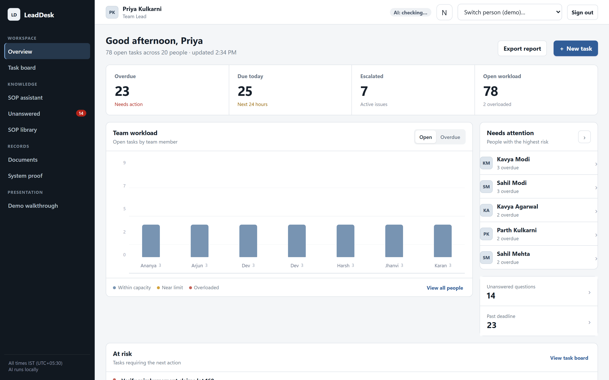
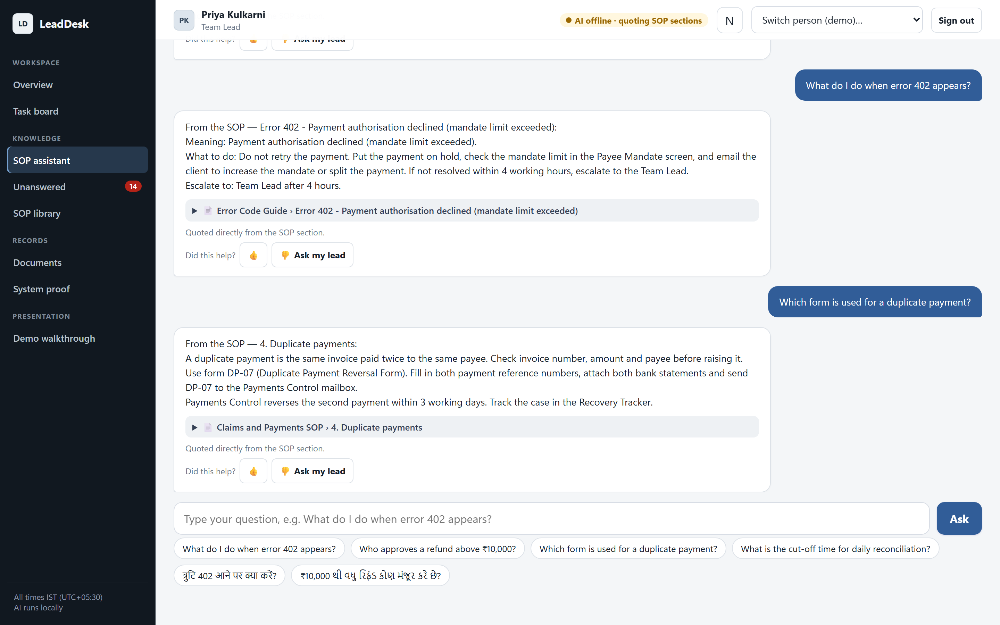
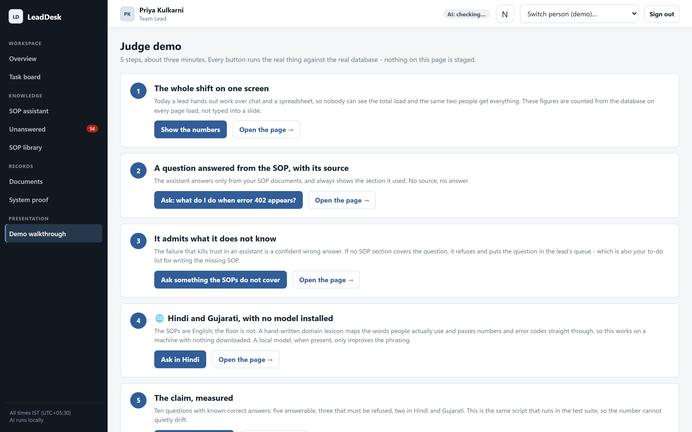
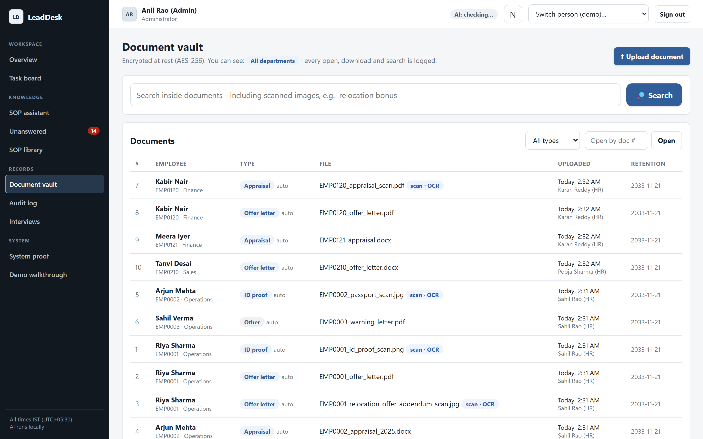

# LeadDesk

One screen for a back-office team lead, plus two supporting tools.

The main product is a **task board + workload view + an SOP assistant that runs on a local AI model**. The other two
tools from the brief are integrated as working MVPs, not mock screens: an **encrypted HR document vault** and an
**interview scheduler**.

Nothing leaves the machine. The assistant answers only from the SOPs the lead uploads, shows the document and
section it used, and hands anything it cannot answer to a "Needs lead" list.

---

## See it

| | |
|---|---|
|  |  |
| The whole shift: 20 people, what is late, who is overloaded. | An answer with its document and section, or none at all. |
|  |  |
| A five-step walkthrough that runs on real API calls. | Encrypted HR documents, with the stored bytes shown for proof. |

More in [`docs/screenshots`](docs/screenshots): task board, needs-lead queue, audit log, interviews, mobile, and the
public booking page.

---

## Run it

### Docker (one command)

```bash
docker compose up --build
```

| What | Where |
|---|---|
| LeadDesk | http://localhost:8000 |
| Every email the app sent (invites, reminders, cancellations) | http://localhost:8025 |
| Local AI model | http://localhost:11434 (Ollama on the host) |

Pull a model once on the host, before the first run:

```bash
ollama pull qwen2.5:3b
```

The app works without Ollama — the assistant then answers with a plain extract-from-the-SOPs fallback and says so in
the UI. With Ollama running it writes the answer in words instead. Both modes cite their source.

**Hindi and Gujarati work either way.** Rather than depend on a model to translate, `app/lexicon.py` maps the domain
words people actually use (*error, refund, approve, form, signature, cut-off*) plus the question words, and passes
numbers and error codes through untouched. So *"त्रुटि 402 आने पर मुझे क्या करना चाहिए?"* finds the Error 402 section on
a machine with nothing installed. When the model *is* running, it translates properly and whichever version retrieves a
better section is used — the model is an upgrade, not a dependency.

### Without Docker

```bash
python -m venv .venv && .venv\Scripts\activate      # Windows
pip install -r requirements.txt
uvicorn app.main:app --reload
```

Tesseract must be installed and on `PATH` for OCR of scanned documents (`C:\Program Files\Tesseract-OCR` is detected
automatically on Windows; `apt-get install tesseract-ocr` elsewhere). Everything except scanning still works without it.

---

## Sign in

First start seeds a full demo: 300 employees, 20 team members on two shifts, ~60 tasks, 3 SOPs, 10 HR documents
(4 of them scans), 5 interviewers and 10 candidates.

Every demo account uses the password **`demo1234`** (or the value of `DEMO_PASSWORD`).

| Username | Who | What they can reach |
|---|---|---|
| `lead` | Priya Kulkarni, Team Lead | everything: board, workload, SOPs, needs-lead list |
| `m01` … `m20` | team members | their own tasks, the assistant |
| `admin` | Anil Rao, Administrator | all vault documents, audit log, delete approvals |
| `hr1` … `hr5` | HR, one per department | vault documents for their own department |
| `int1` … `int5` | interviewers | their availability, their interviews, their feedback forms |
| `tester` | QA tester | team forum only |
| `dev` | developer | team forum only |

The login screen lists demo accounts by persona. Team members can use `m01` … `m20`; every signed-in role can
start discussions and reply in the **Team forum**. Tester and developer accounts are restricted to the forum.

These are shared demo credentials, not production user accounts. Before the app is reachable from anywhere but your
own machine, set `DEMO_MODE=0` (that removes the one-click sign-in and the password endpoint) and give every account a
real password — **Password** in the top bar, or:

```bash
docker compose exec app python scripts/reset_password.py admin 'a-long-new-password'
```

The app prints a warning at startup if `DEMO_MODE=1` and the public URL is not localhost. See
[`docs/DEPLOY.md`](docs/DEPLOY.md).

---

## What is where

| Page | The problem it answers |
|---|---|
| **Board** | What work exists, who has it, what is late. Drag a card, or change status and read the full change history. |
| **Workload** | Who is overloaded against a threshold the lead sets, how many are overdue, what is due today. Export to Excel. |
| **Assistant** | "What do I do when error 402 appears?" — answered from the uploaded SOPs only, with the source shown. |
| **Needs lead** | Every question the SOPs could not answer. This is also the list of gaps in the SOPs. |
| **My tasks** | A member's own queue, with the buttons they actually use. |
| **Vault** | Encrypted HR documents, role-limited, scanned files searchable by content, every action in an audit log. |
| **Interviews** | Interviewers publish availability, candidates book from a link, feedback is independent and structured. |
| **How we know it works** | The measured numbers: eval scores, audit chain check, scan count. |

## Two things worth clicking

- **Vault → any document → "Show the stored file":** prints the raw bytes on disk next to the decrypted text, so you can
  see the stored copy is a `LDV1` blob and not a readable PDF or JPEG.
- **Interviews → "Simulate a race":** two candidates book the same slot at the same instant. Exactly one succeeds. The
  guard is a `BEGIN IMMEDIATE` transaction plus a unique index, not a check in JavaScript.

---

## Layout

```
app/
  main.py         routes, startup, background scheduler
  db.py           SQLite schema (WAL), transactions, IST clock
  auth.py         login, sessions, roles, password change
  security.py     security headers, CSP, login throttle, session lifetime
  tasks.py        task board, workload, notifications, xlsx export
  sop.py          SOP ingestion, sectioning, TF-IDF retrieval, answer gate
  lexicon.py      Hindi/Gujarati domain words, so retrieval works with no model
  llm.py          local Ollama client
  vault.py        envelope encryption, roles, OCR search, hash-chained audit log
  crypto.py       AES-256-GCM file keys wrapped by a master key outside the code
  ocr.py          text extraction: pypdf → pypdfium2 render → Tesseract
  interviews.py   slots, booking links, .ics, reminders, feedback, race guard
  ics.py          calendar file generation
  mailer.py       SMTP to Mailpit, everything also kept in an outbox table
  forum.py        team discussion, restricted roles
  impact.py       the numbers on screen, counted from the database
  seed.py         the demo data
static/           the whole UI: index.html, app.js, styles.css, book.html
sample_data/      the 3 SOPs, 10 HR documents (4 scans), test questions
scripts/          make_samples.py, eval_sop.py, reset_password.py
deploy/           Caddyfile and the production compose file
docs/             USER_GUIDE.md, SECURITY_NOTE.md, DESIGN.md, DEPLOY.md,
                  PITCH.md, REVIEW.md, screenshots/
```

`data/` and `secrets/` are created on first run and are not in git. `data/` holds the database and the encrypted
blobs; `secrets/` holds the vault master key. **Losing `secrets/vault_master.key` makes the vault unreadable** — that is
the point of it, and also the one thing to back up.

## The 5-question eval

The brief asks for at least 4 of 5 test questions answered correctly with a source.

```bash
python scripts/eval_sop.py
```

It runs the questions in `sample_data/test_questions.json`, checks the expected error code or figure against the answer,
and writes `data/eval_results.json`, which is what the **How we know it works** panel displays. There is also a
**Run test questions** button in the Assistant page that does the same thing in the browser.

Current result, **with no model installed at all** (the worst case a judge can hit):

```
Answerable questions correct with source: 5/5
Out-of-scope questions sent to the lead:   3/3
Hindi / Gujarati questions:              2/2
```

Retrieval scores three ways and adds them: word n-grams, character n-grams, and a separate heading field. The heading
field exists because a long SOP body dilutes its own title — *"which form for a duplicate payment"* used to tie between
*4. Duplicate payments* and *Error 409 - Duplicate record* within 0.003. Scoring the heading separately resolves it
correctly, which is the difference between 4/5 and 5/5.

## Deploy

```bash
docker compose up --build                                    # laptop demo
docker compose -f deploy/docker-compose.prod.yml up -d       # VPS behind Caddy, automatic HTTPS
```

The one step that is not optional before a public URL: **`DEMO_MODE=0`** plus real passwords.
[`docs/DEPLOY.md`](docs/DEPLOY.md) has the runbook: environment reference, backups that keep the database and the key
together, firewall, troubleshooting, and the demo-day checklist.

## Docs

| File | For |
|---|---|
| [`docs/PITCH.md`](docs/PITCH.md) | the three-minute script, the numbers, and the questions judges ask |
| [`docs/DEPLOY.md`](docs/DEPLOY.md) | laptop, VPS and hosted deployment; operations |
| [`docs/REVIEW.md`](docs/REVIEW.md) | the full checkup: what was verified, what was fixed, what is a deliberate trade-off |
| [`docs/USER_GUIDE.md`](docs/USER_GUIDE.md) | one page, no jargon, for the person using it |
| [`docs/SECURITY_NOTE.md`](docs/SECURITY_NOTE.md) | encryption, roles, audit chain, and what production would change |
| [`docs/DESIGN.md`](docs/DESIGN.md) | the visual language |
| [`docs/HACKATHON_PLAYBOOK.md`](docs/HACKATHON_PLAYBOOK.md) | what winning entries do, and the scorecard against this one |

## Tests

```bash
python -m pytest tests -q      # 36 tests, ~14 s
```

They cover login and role gates, the multilingual path, the retrieval tie-break, the answer gate, the booking race, the
vault ciphertext, the password change, the login throttle and the security headers.
