# LeadDesk — human tester's guide

**Version 1.0 · 27 Nov 2026**

**Instance under test:** `http://localhost:8000`

The host has prepared this instance. The handover table in section 2 lists
everything you need. Times are **IST**.

This guide is written for a human tester who has never seen the product. You do not
need to read code. Each test has a picture of the path, exact clicks, what a pass
looks like, and the one thing that should fail it.

---

## 1. What you are testing

LeadDesk is one workspace with three products. This run covers **Problem 1** and the
cross-cutting access checks; the document vault (Problem 2) and interview scheduler
(Problem 3) are out of scope here and are checked separately.

| # | Problem statement | What the product does | Where it is tested |
|---|---|---|---|
| **P1** | A team lead cannot see the whole workload, and answers the same SOP questions all day | Task board + workload view + SOP assistant that answers only from uploaded SOPs, cites the source, and hands over what it cannot answer | Sections 1 and 2 |

Section 3 checks the things that cut across the workspace: roles, sign-in, mobile
layout, and the report form itself.

**Your job:** perform each test on the deployed app and mark PASS or FAIL. Do not
try to fix anything.

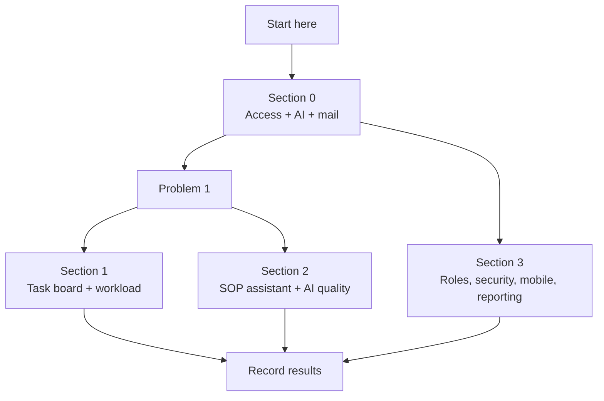

---

## 2. Before you start

**Host handover — provided for this run**

| What | Value |
|---|---|
| Instance | `http://localhost:8000` |
| Test window | From 27 Nov 2026, IST |
| Accounts | The six demo accounts below; password `demo1234` |
| Mail inbox | `http://localhost:8025` (Docker demo) or **Interviews → Sent emails** |
| Sample upload | `http://localhost:8000/static/samples/Tester_Sample_SOP.pdf` |
| AI | `qwen2.5:3b` on local Ollama; first answer 10–60 s |
| Host contact | `trex2004avradeep@gmail.com` |
| Data | Synthetic demo data only — never upload real personal data |
| Browser | Current Edge or Chrome; one normal + one private window |

### 2.1 Accounts

The demo database ships with these accounts. Password for all: **`demo1234`**.
These are the credentials for this instance.

| Login | Name | Role | Use it for |
|---|---|---|---|
| `lead` | Priya Kulkarni | Team Lead | Board, workload, SOP library, needs lead, demo |
| `m01` | Riya Sharma | Team Member (EMP0001) | My tasks, ask the SOPs |
| `hr1` | Sahil Rao | HR / Recruiter (Operations) | Sent emails, role-boundary checks |
| `admin` | Anil Rao | Administrator | Sent emails, role-boundary checks |
| `tester` | LeadDesk Tester | Tester | Forum only; role-boundary test |
| `dev` | LeadDesk Developer | Developer | Forum only; role-boundary test |


### 2.2 Windows and tools

- Use one browser window. A private window is useful only if you want to compare two
  roles side by side; sessions in the same profile overwrite each other.
- Have a small PDF for the SOP upload test (T2.5). If you do not have one, download
  the ready-made sample:
  `http://localhost:8000/static/samples/Tester_Sample_SOP.pdf`
- Find the mail inbox:
  - Docker demo: `http://localhost:8025` (Mailpit, all mail is caught here).
  - Hosted instance: sign in as `hr1` or `admin` → **Interviews** → **Sent emails**.
- The AI model is local. The first answer after a restart can take 10–60 seconds
  while the model loads; later answers are faster.

### 2.3 Test data

Use fictional names and the sample files. **Do not upload real passports, real
salary letters, or any real personal data.** This is a test instance; the seeded
documents are synthetic.

### 2.4 What “AI online” looks like

The top bar shows one of:

- **`Local AI online — qwen2.5:3b`** (green dot) — AI answers are generated by the
  local model.
- **`AI offline — quoting SOP sections`** — the assistant still answers, but by
  quoting the best section. This is a valid fallback, but **T0.2 fails** because the
  deployment was supposed to keep the AI online.

If it says offline, wait 5 minutes on a fresh deployment (the model may still be
downloading), refresh, then report it.

---


## Section 0 — Access, AI and mail (run these first)

### T0.1 — Every role lands on the right page

`all accounts` · Setup · Access


*The login personas - every role enters at its own landing page.*


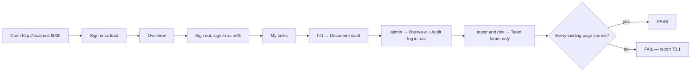

**Do**

1. Sign in as each account in the table in §2.1 (sign out between accounts).
2. For each, note the first page and the left navigation.

**Expect**

| Account | First page | Navigation must include | Must not include |
|---|---|---|---|
| `lead` | Overview | Task board, Ask the SOPs, Needs lead, SOP library, Documents, System proof | Audit log |
| `m01` | My tasks | Ask the SOPs, My documents | Task board, Audit log, Interviews |
| `hr1` | Document vault | Interviews, Ask the SOPs, System proof | Audit log |
| `admin` | Overview | Task board, Document vault, **Audit log**, Interviews, System proof | — |
| `tester` / `dev` | Team forum | Team forum | Everything else |

**Catch:** a member sees the Task board, or `tester` sees the vault.

---

### T0.2 — The AI is online and names its model

`lead` or `m01` · Setup · AI deployment

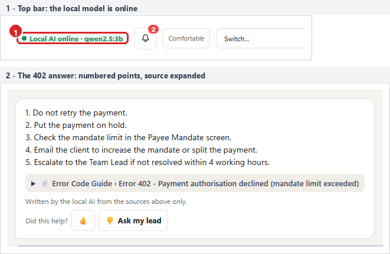

*Top bar shows the local model online; the 402 answer is numbered and cites its SOP section.*


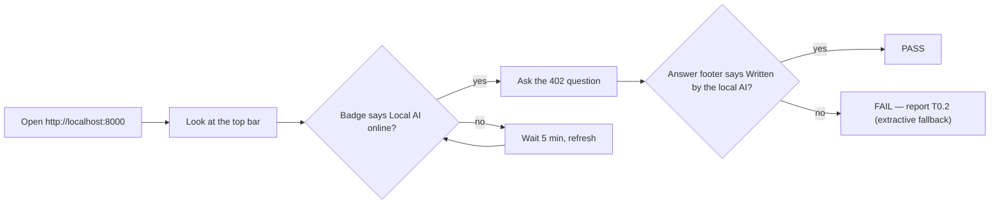

**Do**

1. Sign in as `lead`.
2. Look at the pill in the top bar.
3. Open **Ask the SOPs** and ask: `What do I do when error 402 appears?`

**Expect**

- The badge is green and reads **Local AI online — qwen2.5:3b**.
- The answer arrives within 60 seconds.
- Under the source, the small footer says **“Written by the local AI from the
  sources above only.”** (not “Quoted directly…”).

**Catch:** the badge says online but the answer is extractive, or the badge stays
offline after a refresh and 5 minutes.

---

### T0.3 — Mail can be seen

`hr1` or `admin` · Setup · Mail

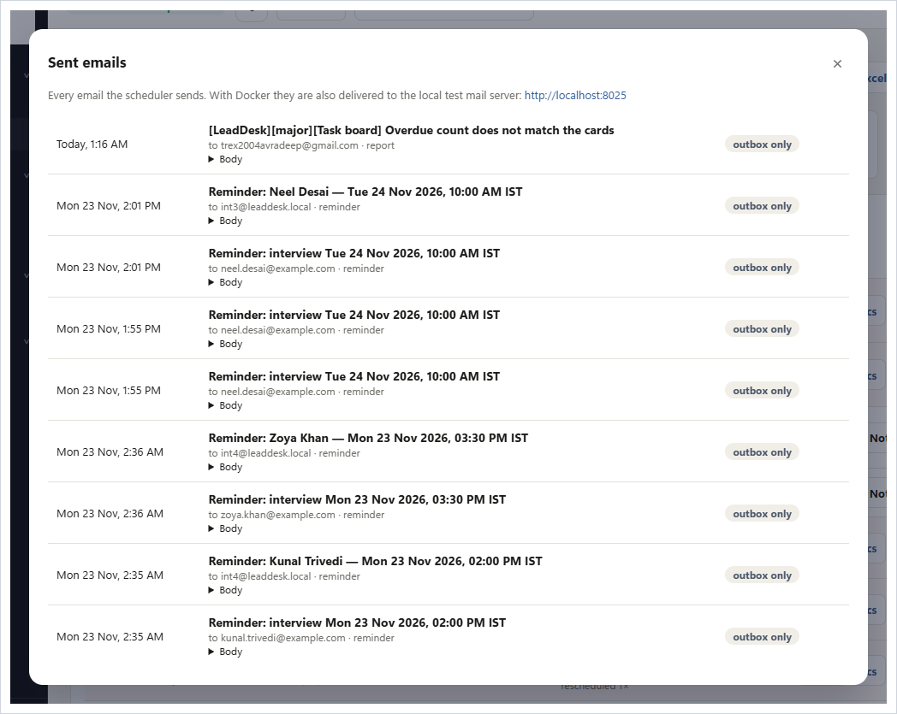

*Interviews -> Sent emails, including reminder and report messages.*


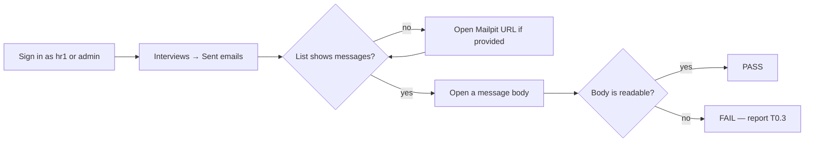

**Do**

1. Sign in as `hr1` (or `admin`).
2. Open **Interviews** → **Sent emails**.
3. Open any message and read the body.
4. If the host runs the Docker demo, open `http://localhost:8025` and confirm the
   same messages are there. On a hosted instance, use **Sent emails**.

**Expect**

- Messages are listed with recipient, subject, time and kind.
- The body is readable, and invite messages offer a `.ics` download.
- In Mailpit, the same messages appear.

**Catch:** no messages at all, or every message says “outbox only” when your
host said SMTP is configured.

---

## Section 1 — Task board and workload (Problem 1)

**What this proves:** a lead can hand out work, see who is overloaded, and a member
sees only their own queue.

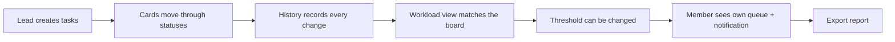

### T1.1 — A lead can create a task with every field

`lead` + `m01` · Problem 1 · Functional


*New task with assignee, type, priority, deadline and description.*


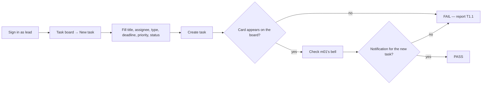

**Do**

1. Sign in as `lead` → **Task board** → **New task**.
2. Enter:
   - Title: `TEST — reconcile HDFC account for 27 Nov`
   - Assign to: **Riya Sharma (Morning shift)**
   - Type: **Reconciliation**
   - Deadline: **2 hours from now** (today, IST)
   - Priority: **High**
   - Status: **Pending**
3. Press **Create task**.
4. In a second window, sign in as `m01` and open the bell.

**Expect**

- The card appears immediately in the **Pending** column with Riya's name, High
  priority and the deadline.
- The form showed Riya's current load before you saved.
- `m01` has a notification: “Task assigned to you: …”, and **My tasks** shows the
  task.
- Clicking the card opens details and history.

**Catch:** the deadline is stored in the wrong time zone, the assignee is not
notified, or the card is missing.

---

### T1.2 — Status changes and history

`lead` · Problem 1 · Functional

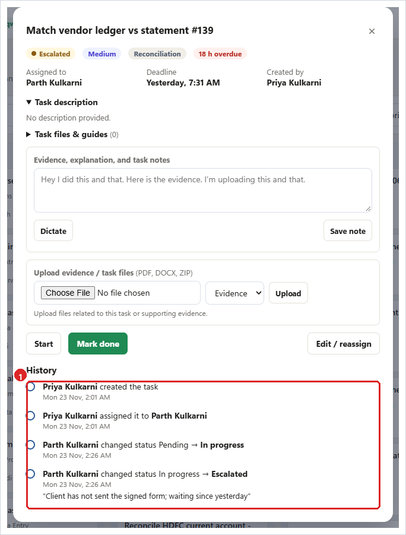

*Task history: created, assigned, status changes and escalation.*


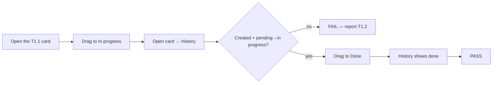

**Do**

1. On **Task board**, drag the T1.1 card from **Pending** to **In progress**.
2. Click the card → **History**.
3. Drag the same card to **Done** and reopen History.

**Expect**

- The card moves and the column counts change.
- History lists, in order: created, status pending → in progress, status in progress
  → done, with the lead's name and timestamps.
- The done card leaves the open workload count.

**Catch:** the drag does nothing, the history is empty, or the change is attributed
to the wrong user.

---

### T1.3 — Overdue and due-today numbers agree with the cards

`lead` · Problem 1 · Data

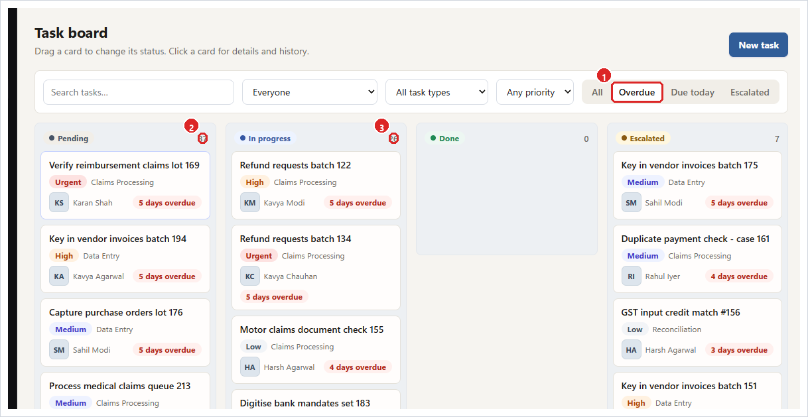

*Board filtered to Overdue; column counts match the cards.*


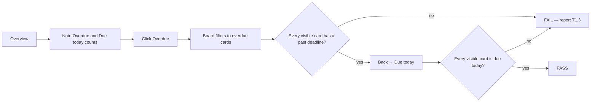

**Do**

1. As `lead`, open **Overview** and note the **Overdue** and **Due today** numbers.
2. Click the **Overdue** metric. The board opens with the **Overdue** filter on.
3. Compare the number of visible cards with the metric.
4. Go back and click **Due today**; repeat.

**Expect**

- The filter is visibly selected on the board.
- Every overdue card has a deadline in the past; every due-today card has today's
  date.
- The visible counts match the metric (allow for the done column being capped at 15
  cards; overdue/due-today are open tasks).

**Catch:** the filter opens the board but does not filter, or the counts disagree.

---

### T1.4 — Workload chart and the lead-set threshold

`lead` · Problem 1 · Data + control

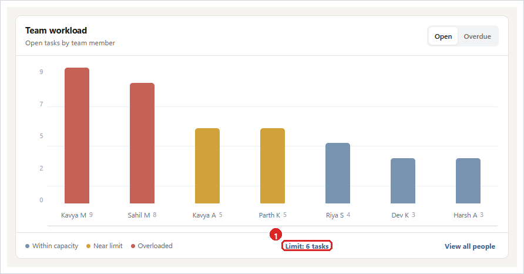

*Workload sorted by load, with the lead-set limit line.*


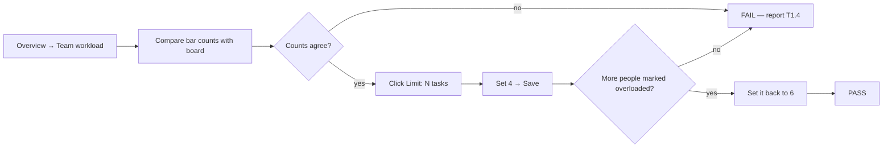

**Do**

1. On **Overview**, read **Team workload**. For two people, compare the bar number
   with their open tasks on the board (filter by that person).
2. Click **Limit: N tasks** in the chart footer.
3. Set the limit to **4** and save.
4. Confirm the overload markers change; then set it back to **6**.

**Expect**

- The per-person numbers match the board's open tasks (not done).
- The modal opens with the current limit; saving shows a toast and re-renders.
- At 4, at least as many people are marked overloaded as at 6 (usually more).
- Restoring 6 returns the original picture.

**Catch:** the limit button is missing, saving does nothing, or the bars do not
react.

---

### T1.5 — A member sees only their own work

`m01` · Problem 1 · Permissions

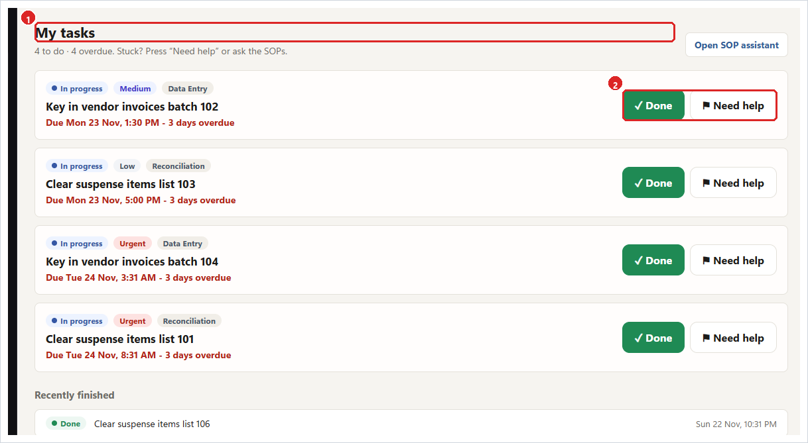

*A member's own queue, with overdue work first.*


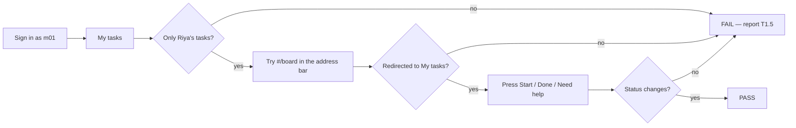

**Do**

1. Sign in as `m01` → **My tasks**.
2. Confirm every task is assigned to Riya Sharma.
3. Put `#/board` at the end of the URL and press Enter.
4. Press **Start** on a pending task, then **Done** on it, then **Need help** on
   another.

**Expect**

- No other member's tasks appear.
- `#/board` redirects to **My tasks** (no lead board, no New task button).
- The status buttons work and the card updates. **Need help** escalates it and shows
  “Waiting for lead”.

**Catch:** another person's task is visible, or the member can reach the board.

---

### T1.6 — Workload export opens

`lead` · Problem 1 · Output


*Workload export dialog.*


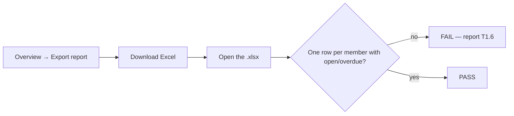

**Do**

1. On **Overview**, press **Export report**.
2. Choose **Excel (.xlsx)**.
3. Open the file.

**Expect**

- The file downloads and opens without a repair prompt.
- It has one row per team member, with open tasks, overdue tasks and the overload
  flag, plus a generated-at timestamp.
- The numbers match the Overview.

**Catch:** a corrupt file, a login page saved as `.xlsx`, or numbers that do not
match.

---

## Section 2 — SOP assistant and AI answer quality (Problem 1)

**What this proves:** the assistant answers only from the uploaded SOPs, cites the
document and section, refuses what it does not know, and survives Hindi and
Gujarati questions without a translation service.

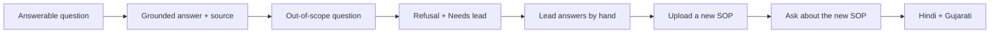

### T2.1 — Error 402 is answered with its source

`lead` (or `m01`) · Problem 1 · AI quality

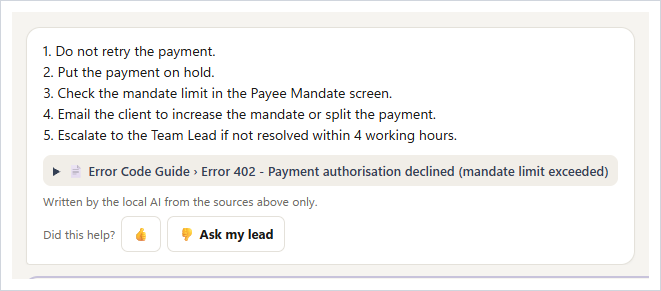

*Error 402 answered as numbered steps, with the source section expanded.*


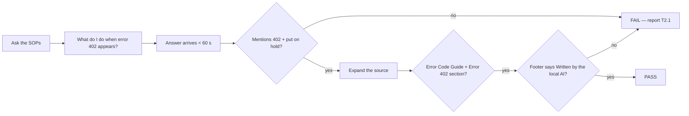

**Do**

1. Sign in as `lead` → **Ask the SOPs**.
2. Ask: `What do I do when error 402 appears?`
3. Expand the source disclosure under the answer.

**Expect**

- The answer says, in substance: do not retry, put the payment **on hold**, check
  the mandate limit, email the client, and escalate within **4 working hours**.
- The source is **Error Code Guide** → **Error 402 – Payment authorisation declined
  (mandate limit exceeded)**.
- The footer says **“Written by the local AI from the sources above only.”**
- The **Did this help?** buttons appear.

**Answer-quality check:** every step in the answer must appear in the quoted
excerpt. If the model adds a step that is not in the SOP, mark **S2** even if the
rest is right.

---

### T2.2 — A second policy question keeps its number and approver

`m01` · Problem 1 · AI quality


*Refund threshold answered with the approver and the source.*


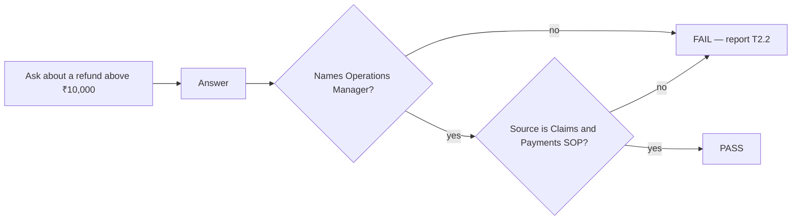

**Do**

1. As `m01`, ask: `Who approves a refund above ₹10,000?`

**Expect**

- The answer names the **Operations Manager** (and any second approver the SOP
  names).
- The source is **Claims and Payments SOP**, with a section about refunds.
- The rupee amount is not changed or rounded.

**Catch:** the approver is wrong, the amount is dropped, or the source is a
different document.

---

### T2.3 — Out-of-scope questions are refused and handed to the lead

`m01` + `lead` · Problem 1 · Guardrail + workflow


*Refusal, the lead's Needs lead queue, and the lead's answer back to the member.*


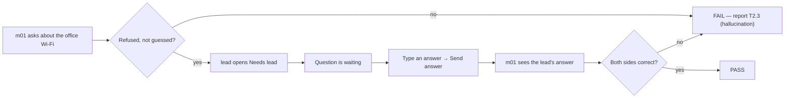

**Do**

1. As `m01`, ask: `What is the office Wi-Fi password?`
2. As `lead`, open **Needs lead** (the **Waiting** tab).
3. Find the question, type a short answer, press **Send answer**.
4. Back as `m01`, reopen **Ask the SOPs** and read the thread.

**Expect**

- The assistant says it could not find the answer in the SOPs and that the question
  was passed to the team lead. It does **not** invent a password.
- The question appears in Needs lead with the asker, time and match score.
- After the lead answers, `m01` sees “Answer from your team lead: …” and the
  question is no longer in the Waiting tab.

**Catch:** a fabricated answer, the question missing from Needs lead, or the
member never sees the reply.

---

### T2.4 — The hallucination guard holds for an invented code

`m01` · Problem 1 · Guardrail

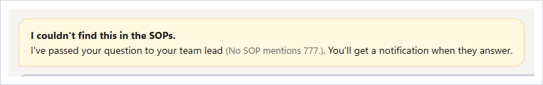

*An invented error code is refused, not guessed.*


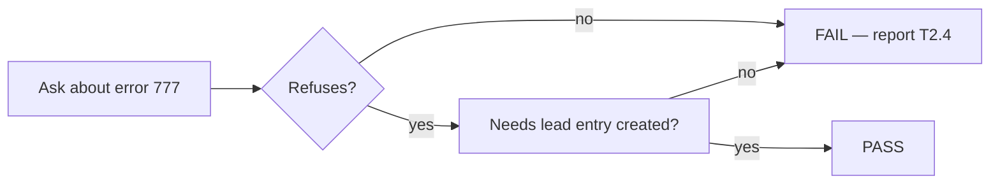

**Do**

1. As `m01`, ask: `What do I do when error 777 appears?`
2. Check **Needs lead** as `lead`.

**Expect**

- Refusal, with the reason that no SOP section matches closely enough.
- No invented steps, no invented escalation path.
- A new entry in **Needs lead**.

**Catch:** the assistant “helpfully” invents a procedure for 777.

---

### T2.5 — A newly uploaded SOP is indexed and used

`lead` · Problem 1 · Upload + retrieval


*SOP library upload; the new document is indexed with its section count.*


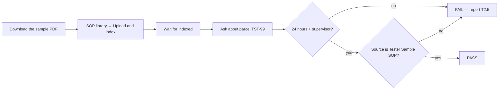

**Do**

1. Download `http://localhost:8000/static/samples/Tester_Sample_SOP.pdf`.
2. As `lead`, open **SOP library**.
3. Choose the file → **Upload and index**. Wait for the success message and the
   section count.
4. Open **Ask the SOPs** and ask:
   `What should I do when a parcel is marked TST-99?`

**Expect**

- The library lists **Tester Sample SOP** and its sections.
- The answer says to **hold it for 24 hours** and **inform the shift supervisor**
  before releasing it (and not to open it).
- The source is **Tester Sample SOP**, and the quoted excerpt contains TST-99.

**Catch:** the upload fails, the document is not searchable, or the answer comes
from a different SOP.

**Clean-up (optional):** delete the sample SOP from the library if the next tester
should start clean.

---

### T2.6 — Hindi and Gujarati questions still find the English SOP

`m01` · Problem 1 · Language


*Hindi and Gujarati questions, both answered from the English SOP with sources.*


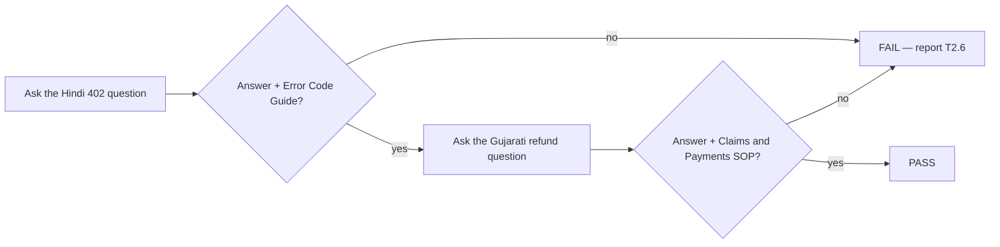

**Do**

1. As `m01`, ask: `त्रुटि 402 आने पर मुझे क्या करना चाहिए?`
2. Then ask: `₹10,000 થી વધુ રિફંડ કોણ મંજૂર કરે છે?`

**Expect**

- Both get an answer, not a “no match”.
- Hindi answer mentions 402 and cites **Error Code Guide**.
- Gujarati answer names the approver (Operations Manager) and cites **Claims and
  Payments SOP**.
- If the answer is in Hindi/Gujarati, an **English answer** disclosure is shown.

**Catch:** the question is refused, or the source is unrelated.

---


## Section 3 — Cross-cutting access, security and UX

**What this proves:** the roles hold outside the happy path, sign-in resists
guessing, the app works on a phone, and testers can report problems.

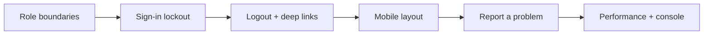

### T3.1 — Role boundaries hold on direct URLs

`m01`, `hr1`, `tester` · Cross-cutting · Permissions


*tester opening #/vault lands on the forum - no vault data.*


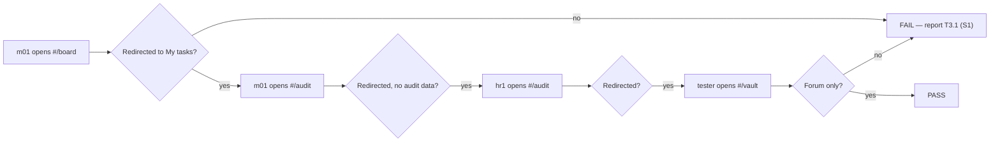

**Do**

1. As `m01`, put `#/board` in the URL.
2. As `m01`, put `#/audit` in the URL.
3. As `hr1`, put `#/audit` in the URL.
4. As `tester`, put `#/vault` in the URL.
5. As `tester`, try to open a vault document by number.

**Expect**

- Every attempt lands on that role's home page (or a clear denial), never on the
  lead/admin page.
- No audit entries, salaries or documents are rendered.
- The API, not just the menu, refuses the action.

**Catch:** a page renders data outside the role. **S1**.

---

### T3.2 — Five wrong passwords lock the account for 60 seconds

`tester` · Cross-cutting · Brute force


*Lockout after five failures: 'Too many failed attempts. Try again in 59 seconds.'*


```mermaid
flowchart LR
  A["Sign out"] --> B["Wrong password ×5 for tester"]
  B --> C{"Locked message?"}
  C -->|no| X["FAIL — report T3.2"]
  C -->|yes| D["Wait 60 s, sign in correctly"]
  D --> E{"Sign-in works again?"}
  E -->|yes| P[PASS]
  E -->|no| X
```

**Do**

1. Sign out.
2. Try `tester` with a wrong password five times.
3. Try the correct password once.
4. Wait 60 seconds and try the correct password again.

**Expect**

- After five failures, sign-in is refused with a lockout message for that account
  and this IP.
- The correct password is also refused while locked.
- After 60 seconds, the correct password works.

**Catch:** unlimited guesses, or the lockout never expires. Do **not** run this on
`lead` or `admin` if other testers are working.

---

### T3.3 — Sign-out and deep links do not restore a session

`lead` · Cross-cutting · Session

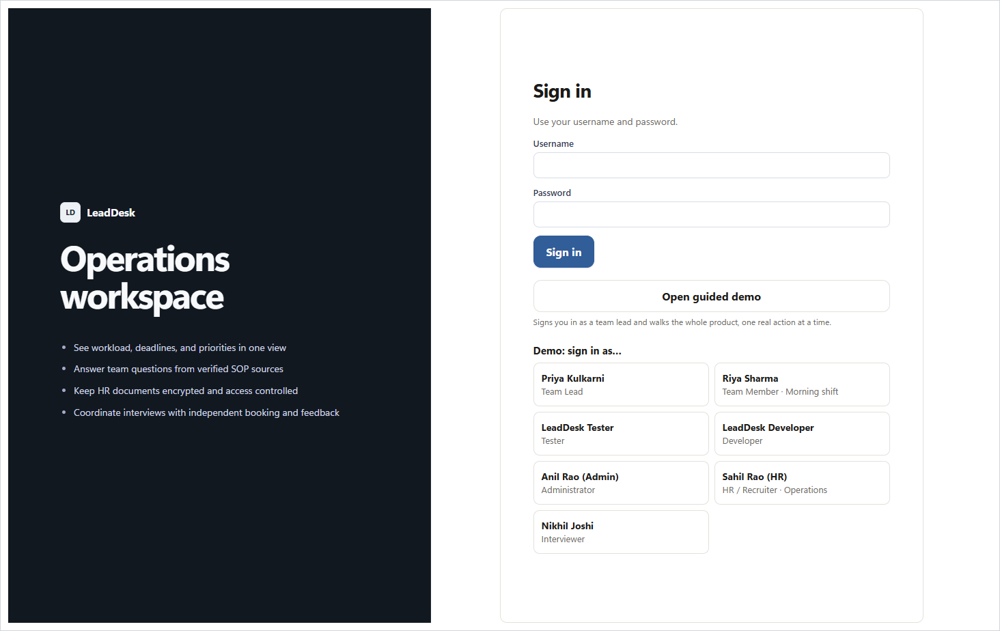

*After Sign out, Back and deep links return to the login page.*


```mermaid
flowchart LR
  A["Sign in as lead"] --> B["Sign out"]
  B --> C{"Login page?"}
  C -->|no| X["FAIL — report T3.3"]
  C -->|yes| D["Press Back"]
  D --> E{"No data, still signed out?"}
  E -->|yes| F["Open #/audit directly"]
  F --> G{"Redirected to login?"}
  G -->|yes| P[PASS]
  G -->|no| X
```

**Do**

1. Sign in as `lead`, then sign out.
2. Press the browser Back button.
3. Open `http://localhost:8000/#/audit` directly.

**Expect**

- Sign-out returns to the login page.
- Back does not restore the workspace or cached personal data.
- The deep link redirects to the login page (or denies), not to an audit view.

**Catch:** the workspace is still visible after sign-out.

---

### T3.4 — The app is usable at phone width

`m01` · Cross-cutting · Responsive


*390 px phone layout: no horizontal scroll, bottom navigation.*


```mermaid
flowchart LR
  A["Open DevTools device mode at 390 px"] --> B["My tasks"]
  B --> C{"No horizontal scrolling?"}
  C -->|no| X["FAIL — report T3.4"]
  C -->|yes| D["Open the menu"]
  D --> E{"Drawer navigates?"}
  E -->|yes| F["Open the assistant + a task"]
  F --> G{"Readable and tappable?"}
  G -->|yes| P[PASS]
  G -->|no| X
```

**Do**

1. In Chrome, open DevTools → device toolbar → **iPhone 14 / 390 px**.
2. Sign in as `m01`.
3. Navigate: **My tasks**, open a task, **Ask the SOPs**, send a question, open the
   menu and go to another page.
4. Repeat on the public booking page (private window).

**Expect**

- No horizontal scrollbar on any page.
- The bottom tabs and the hamburger menu work; the drawer closes after navigation.
- Buttons are large enough to tap; text does not overlap.
- The assistant input stays visible above the keyboard area.

**Catch:** content cut off, a table that cannot be scrolled, or a menu that traps
you.

---

### T3.5 — The in-app report reaches the team

`m01` · Cross-cutting · Reporting

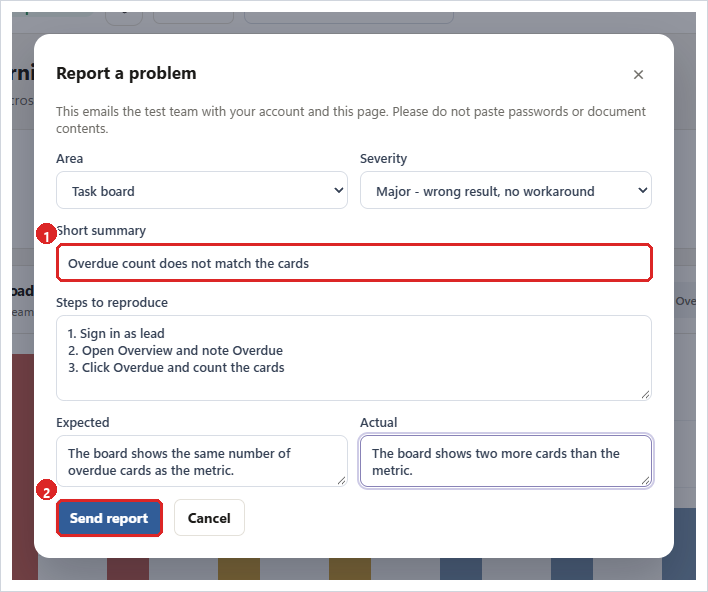

*Filled Report a problem dialog with area, severity, summary and steps.*


```mermaid
flowchart LR
  A["Account menu → Report a problem"] --> B["Fill area, severity, summary, steps"]
  B --> C["Send report"]
  C --> D{"Toast: Report sent?"}
  D -->|no| X["FAIL — report T3.5"]
  D -->|yes| E["Check Mailpit or Sent emails"]
  E --> F{"Subject starts [LeadDesk][severity][area]?"}
  F -->|yes| G{"Body has account, page, steps?"}
  G -->|yes| P[PASS]
  G -->|no| X
```

**Do**

1. As `m01`, open the account menu → **Report a problem**.
2. Area: **Interviews**; Severity: **Major**; Summary:
   `T3.5 test report — please ignore`; Steps: `1. Open the form 2. Press Send`.
3. Press **Send report**.
4. Check Mailpit / **Sent emails**.

**Expect**

- A success toast appears and the modal closes.
- The email subject is
  `[LeadDesk][major][Interviews] T3.5 test report — please ignore`.
- The body includes the sender's name, username and role, the page URL, the steps,
  expected and actual.
- The message is listed even if SMTP is down (outbox only).

**Catch:** the form errors, nothing is stored, or the body is missing fields.

**This report is a test — tell the host it was a drill.**

---

### T3.6 — Pages load cleanly and the AI answers in time

`lead` · Cross-cutting · Performance


*Local AI online (qwen2.5:3b) and 25 SOP sections indexed.*


```mermaid
flowchart LR
  A["Open DevTools Console"] --> B["Visit Overview, Board, Assistant"]
  B --> C{"Any red errors on load?"}
  C -->|no| D["Ask one SOP question"]
  C -->|yes| X["FAIL — screenshot console + report T3.6"]
  D --> E{"Answer under 60 s?"}
  E -->|yes| F{"Pages feel responsive (< 2 s on LAN)?"}
  F -->|yes| P[PASS]
  F -->|no| X
  E -->|no| X
```

**Do**

1. Open DevTools → Console. Keep it open.
2. Visit Overview, Task board, and Ask the SOPs.
3. Ask the 402 question once.

**Expect**

- No red console errors on load (a single 401 from `/api/auth/me` before signing in
  is expected; ignore it).
- Pages render in under ~2 seconds on the local network; no infinite spinners.
- The AI answer arrives in under 60 seconds; the typing indicator is visible while
  waiting.
- No layout jump that moves the input out from under the cursor.

**Catch:** a 500, a red stack trace, a page stuck on “Loading…”, or the assistant
never returns.

---


## 4. Known limits — do not report these as bugs

| Behaviour | Why it is expected |
|---|---|
| AI badge says offline, answers still arrive | The assistant falls back to quoting the best SOP section. Report it under **T0.2** if the deployment promised an online model, but the answer itself is not wrong. |
| The first AI answer is slow | The model loads on first use; later answers are faster. |
| `tester` and `dev` see only the forum | Those roles are intentionally restricted. |
| Mailpit receives everything in the demo | It is a test inbox, not a real mail service. |
| Sample data is synthetic | Names, salaries and documents are fabricated for the demo. |

---

## Appendix A — Copy-paste test data

### Questions

| Purpose | Exact text | Expected |
|---|---|---|
| T2.1 | `What do I do when error 402 appears?` | 402, hold, Error Code Guide |
| T2.2 | `Who approves a refund above ₹10,000?` | Operations Manager, Claims and Payments SOP |
| T2.3 | `What is the office Wi-Fi password?` | Refused + Needs lead |
| T2.4 | `What do I do when error 777 appears?` | Refused + Needs lead |
| T2.5 | `What should I do when a parcel is marked TST-99?` | 24 hours, shift supervisor, Tester Sample SOP |
| T2.6 | `त्रुटि 402 आने पर मुझे क्या करना चाहिए?` | 402, Error Code Guide |
| T2.6 | `₹10,000 થી વધુ રિફંડ કોણ મંજૂર કરે છે?` | Operations Manager, Claims and Payments SOP |


### Sample SOP for upload

`http://localhost:8000/static/samples/Tester_Sample_SOP.pdf` — a one-page fictional procedure
with the code **TST-99**.

---

