# LeadDesk — human tester's guide

**Version 1.0 · 27 Nov 2026**
**Instance under test:** `____________________________` (your organiser fills this in)

Everywhere this guide says `BASE_URL`, use that address. The local demo is
`http://localhost:8000`. Times are **IST**.

This guide is written for a human tester who has never seen the product. You do not
need to read code. Each test has a picture of the path, exact clicks, what a pass
looks like, and a one-line way to report a failure.

---

## 1. What you are testing

LeadDesk is one workspace with three products built from three problem statements:

| # | Problem statement | What the product does | Where it is tested |
|---|---|---|---|
| **P1** | A team lead cannot see the whole workload, and answers the same SOP questions all day | Task board + workload view + SOP assistant that answers only from uploaded SOPs, cites the source, and hands over what it cannot answer | Sections 1 and 2 |
| **P2** | HR files sit in shared, unencrypted folders; scans cannot be searched; nobody can say who opened what | Encrypted document vault with role-based access, OCR search, watermarked downloads and an append-only audit log | Section 3 |
| **P3** | Recruiters chase availability across messages; double bookings happen; feedback arrives late and inconsistently | Interview scheduler with availability, unique booking links, double-booking guard, `.ics` invites, reminders and independent feedback | Section 4 |

Section 5 checks the things that cut across all three: roles, sign-in, mobile
layout, and the report form itself.

**Your job:** perform each test on the deployed app, mark PASS or FAIL, and email a
report for anything that fails. Do not try to fix anything.

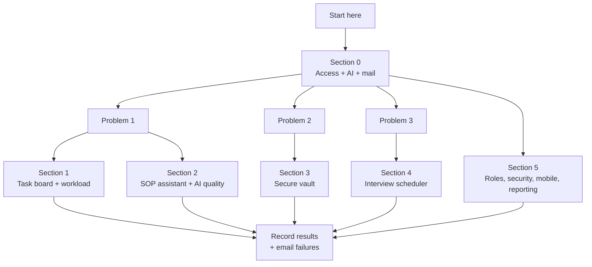

---

## 2. Before you start

### 2.1 Accounts

The demo database ships with these accounts. Password for all: **`demo1234`**.
If your organiser gave you different credentials, use those and ignore this table.

| Login | Name | Role | Use it for |
|---|---|---|---|
| `lead` | Priya Kulkarni | Team Lead | Board, workload, SOP library, needs lead, demo |
| `m01` | Riya Sharma | Team Member (EMP0001) | My tasks, ask the SOPs, own vault documents |
| `hr1` | Sahil Rao | HR / Recruiter (Operations) | Department vault, interviews board, invite candidates |
| `admin` | Anil Rao | Administrator | Audit log, ciphertext proof, all documents, race simulator |
| `int1` | Nikhil Joshi | Interviewer | Availability, my interviews, feedback |
| `int2` | Sonal Bhatt | Interviewer | Second feedback opinion |
| `tester` | LeadDesk Tester | Tester | Forum only; role-boundary test |
| `dev` | LeadDesk Developer | Developer | Forum only; role-boundary test |

`int2` is not on the one-click demo list. Type the username and password manually.

### 2.2 Windows and tools

- Use **two browser windows**: a normal window for staff accounts and a **private /
  incognito** window for the candidate booking flow. Sessions in the same profile
  overwrite each other.
- Keep one extra private window for the double-booking test.
- Have a PDF or DOCX on your machine for the upload tests. If you do not have one,
  download the ready-made sample:
  `BASE_URL/static/samples/Tester_Sample_SOP.pdf`
- Find the mail inbox:
  - Docker demo: `http://localhost:8025` (Mailpit, all mail is caught here).
  - Hosted instance: sign in as `hr1` or `admin` → **Interviews** → **Sent emails**.
- The AI model is local. The first answer after a restart can take 10–60 seconds
  while the model loads; later answers are faster.

### 2.3 Test data

Use fictional names and the sample files. **Do not upload real passports, real
salary letters, or any real personal data.** The vault is encrypted, but this is a
test instance. The seeded documents are synthetic.

### 2.4 What “AI online” looks like

The top bar shows one of:

- **`Local AI online — qwen2.5:3b`** (green dot) — AI answers are generated by the
  local model.
- **`AI offline — quoting SOP sections`** — the assistant still answers, but by
  quoting the best section. This is a valid fallback, but **T0.2 fails** because the
  deployment was supposed to keep the AI online.

If it says offline, wait 5 minutes on a fresh deployment (the model may still be
downloading), refresh, then report it.

---

## 3. How to grade and report

### 3.1 Result codes

| Code | Meaning |
|---|---|
| **PASS** | Every expected bullet happened |
| **FAIL** | At least one expected bullet did not happen |
| **BLOCKED** | You could not run the test (missing account, no file, AI still downloading) |
| **N/A** | The feature is deliberately not configured on this instance (for example Google Calendar) |

### 3.2 Severity

| Severity | Use it when |
|---|---|
| **S1 Blocker** | You cannot sign in, the app is down, data is lost, or a role sees data it must not see |
| **S2 Major** | A main flow gives a wrong result: booking double-books, an answer invents steps, search misses a scan |
| **S3 Minor** | The flow works but something is wrong or confusing; a workaround exists |
| **S4 Cosmetic** | Wording, spacing, colour, a typo |

### 3.3 How to report (preferred: in the app)

1. Open the account menu (your name, bottom of the left rail).
2. Choose **Report a problem**.
3. Fill Area, Severity, a short summary, steps, expected and actual. The page is
   attached automatically.
4. Press **Send report**. You should see *“Report sent to the test team.”*

The report is emailed to the address configured in `TEST_REPORT_EMAIL` (the local
demo uses `trex2004avradeep@gmail.com`). If mail is not configured, the report is
still kept in **Interviews → Sent emails**.

### 3.4 Fallback: email directly

Send to **`trex2004avradeep@gmail.com`**.

**Subject**

```
[LeadDesk][T3.4][FAIL] Search shows another department's document
```

**Body**

```
Instance: https://...
Account: hr1
Browser / OS: Chrome 131 / Windows 11
Time (IST): 27 Nov 2026, 15:42
AI badge: online / offline
Test: T3.4

Steps
1.
2.

Expected
-

Actual
-

Evidence: screenshot attached (and console errors if any)
```

Attach one screenshot of the expected state and one of the actual state. For email
tests, screenshot the mail. Never include passwords or real document contents.

### 3.5 The one rule

**One test = one report.** If three tests fail, send three reports. It makes triage
possible and stops fixes from getting lost inside a long email.

---

## Section 0 — Access, AI and mail (run these first)

### T0.1 — Every role lands on the right page

`all accounts` · Setup · Access

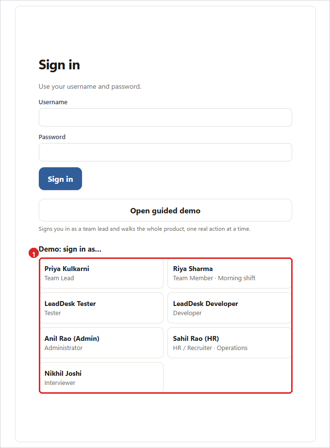

*The login personas - every role enters at its own landing page.*


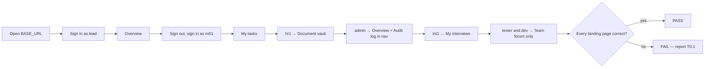

**Do**

1. Sign in as each account in the table in §2.1 (sign out between accounts).
2. For each, note the first page and the left navigation.

**Expect**

| Account | First page | Navigation must include | Must not include |
|---|---|---|---|
| `lead` | Overview | Task board, Ask the SOPs, Needs lead, SOP library, Documents, System proof | Audit log |
| `m01` | My tasks | Ask the SOPs, My documents | Task board, Audit log, Interviews |
| `hr1` | Document vault | Interviews, Ask the SOPs, System proof | Audit log |
| `admin` | Overview | Task board, Document vault, **Audit log**, Interviews, System proof | — |
| `int1` | My interviews | Availability | Vault, Audit log |
| `tester` / `dev` | Team forum | Team forum | Everything else |

**Catch:** a member sees the Task board, or `tester` sees the vault.

---

### T0.2 — The AI is online and names its model

`lead` or `m01` · Setup · AI deployment


*Top bar shows the local model online; the 402 answer is numbered and cites its SOP section.*


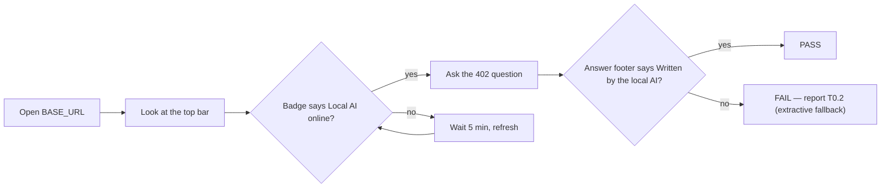

**Do**

1. Sign in as `lead`.
2. Look at the pill in the top bar.
3. Open **Ask the SOPs** and ask: `What do I do when error 402 appears?`

**Expect**

- The badge is green and reads **Local AI online — qwen2.5:3b**.
- The answer arrives within 60 seconds.
- Under the source, the small footer says **“Written by the local AI from the
  sources above only.”** (not “Quoted directly…”).

**Catch:** the badge says online but the answer is extractive, or the badge stays
offline after a refresh and 5 minutes.

---

### T0.3 — Mail can be seen

`hr1` or `admin` · Setup · Mail


*Interviews -> Sent emails, including reminder and report messages.*


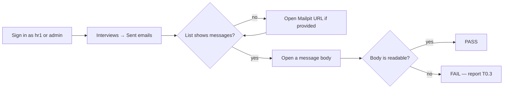

**Do**

1. Sign in as `hr1` (or `admin`).
2. Open **Interviews** → **Sent emails**.
3. Open any message and read the body.
4. If your organiser gave you a Mailpit URL (`http://localhost:8025` on the local
   Docker demo), open it and confirm the same messages are there.

**Expect**

- Messages are listed with recipient, subject, time and kind.
- The body is readable, and invite messages offer a `.ics` download.
- In Mailpit, the same messages appear.

**Catch:** no messages at all, or every message says “outbox only” when your
organiser said SMTP is configured.

---

## Section 1 — Task board and workload (Problem 1)

**What this proves:** a lead can hand out work, see who is overloaded, and a member
sees only their own queue.

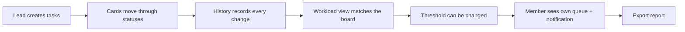

### T1.1 — A lead can create a task with every field

`lead` + `m01` · Problem 1 · Functional

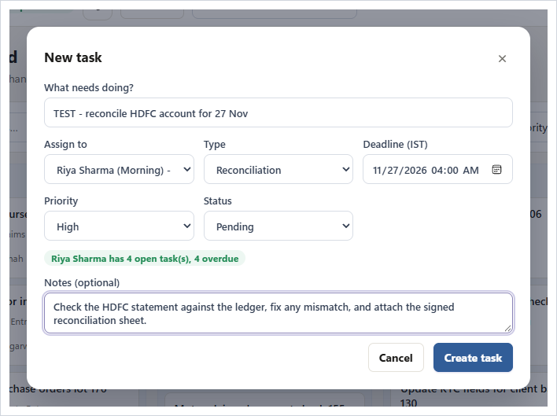

*New task with assignee, type, priority, deadline and description.*


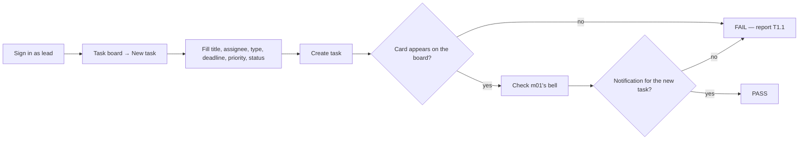

**Do**

1. Sign in as `lead` → **Task board** → **New task**.
2. Enter:
   - Title: `TEST — reconcile HDFC account for 27 Nov`
   - Assign to: **Riya Sharma (Morning shift)**
   - Type: **Reconciliation**
   - Deadline: **2 hours from now** (today, IST)
   - Priority: **High**
   - Status: **Pending**
3. Press **Create task**.
4. In a second window, sign in as `m01` and open the bell.

**Expect**

- The card appears immediately in the **Pending** column with Riya's name, High
  priority and the deadline.
- The form showed Riya's current load before you saved.
- `m01` has a notification: “Task assigned to you: …”, and **My tasks** shows the
  task.
- Clicking the card opens details and history.

**Catch:** the deadline is stored in the wrong time zone, the assignee is not
notified, or the card is missing.

---

### T1.2 — Status changes and history

`lead` · Problem 1 · Functional


*Task history: created, assigned, status changes and escalation.*


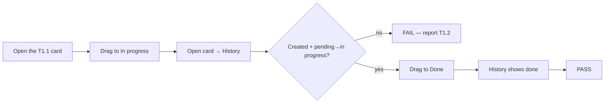

**Do**

1. On **Task board**, drag the T1.1 card from **Pending** to **In progress**.
2. Click the card → **History**.
3. Drag the same card to **Done** and reopen History.

**Expect**

- The card moves and the column counts change.
- History lists, in order: created, status pending → in progress, status in progress
  → done, with the lead's name and timestamps.
- The done card leaves the open workload count.

**Catch:** the drag does nothing, the history is empty, or the change is attributed
to the wrong user.

---

### T1.3 — Overdue and due-today numbers agree with the cards

`lead` · Problem 1 · Data


*Board filtered to Overdue; column counts match the cards.*


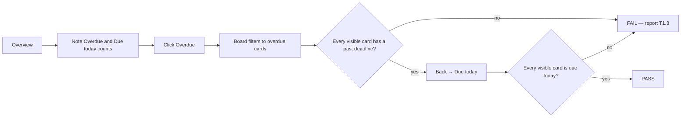

**Do**

1. As `lead`, open **Overview** and note the **Overdue** and **Due today** numbers.
2. Click the **Overdue** metric. The board opens with the **Overdue** filter on.
3. Compare the number of visible cards with the metric.
4. Go back and click **Due today**; repeat.

**Expect**

- The filter is visibly selected on the board.
- Every overdue card has a deadline in the past; every due-today card has today's
  date.
- The visible counts match the metric (allow for the done column being capped at 15
  cards; overdue/due-today are open tasks).

**Catch:** the filter opens the board but does not filter, or the counts disagree.

---

### T1.4 — Workload chart and the lead-set threshold

`lead` · Problem 1 · Data + control


*Workload sorted by load, with the lead-set limit line.*


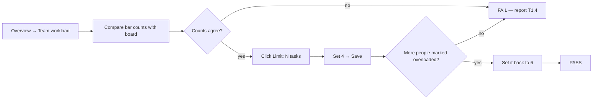

**Do**

1. On **Overview**, read **Team workload**. For two people, compare the bar number
   with their open tasks on the board (filter by that person).
2. Click **Limit: N tasks** in the chart footer.
3. Set the limit to **4** and save.
4. Confirm the overload markers change; then set it back to **6**.

**Expect**

- The per-person numbers match the board's open tasks (not done).
- The modal opens with the current limit; saving shows a toast and re-renders.
- At 4, at least as many people are marked overloaded as at 6 (usually more).
- Restoring 6 returns the original picture.

**Catch:** the limit button is missing, saving does nothing, or the bars do not
react.

---

### T1.5 — A member sees only their own work

`m01` · Problem 1 · Permissions


*A member's own queue, with overdue work first.*


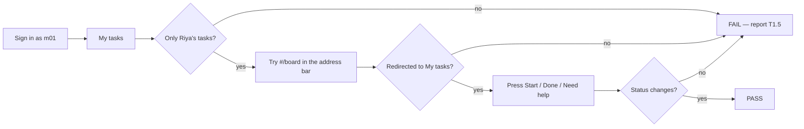

**Do**

1. Sign in as `m01` → **My tasks**.
2. Confirm every task is assigned to Riya Sharma.
3. Put `#/board` at the end of the URL and press Enter.
4. Press **Start** on a pending task, then **Done** on it, then **Need help** on
   another.

**Expect**

- No other member's tasks appear.
- `#/board` redirects to **My tasks** (no lead board, no New task button).
- The status buttons work and the card updates. **Need help** escalates it and shows
  “Waiting for lead”.

**Catch:** another person's task is visible, or the member can reach the board.

---

### T1.6 — Workload export opens

`lead` · Problem 1 · Output

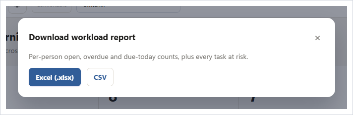

*Workload export dialog.*


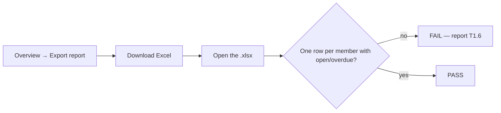

**Do**

1. On **Overview**, press **Export report**.
2. Choose **Excel (.xlsx)**.
3. Open the file.

**Expect**

- The file downloads and opens without a repair prompt.
- It has one row per team member, with open tasks, overdue tasks and the overload
  flag, plus a generated-at timestamp.
- The numbers match the Overview.

**Catch:** a corrupt file, a login page saved as `.xlsx`, or numbers that do not
match.

---

## Section 2 — SOP assistant and AI answer quality (Problem 1)

**What this proves:** the assistant answers only from the uploaded SOPs, cites the
document and section, refuses what it does not know, and survives Hindi and
Gujarati questions without a translation service.

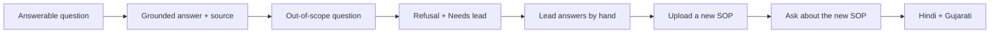

### T2.1 — Error 402 is answered with its source

`lead` (or `m01`) · Problem 1 · AI quality


*Error 402 answered as numbered steps, with the source section expanded.*


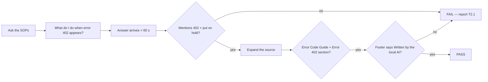

**Do**

1. Sign in as `lead` → **Ask the SOPs**.
2. Ask: `What do I do when error 402 appears?`
3. Expand the source disclosure under the answer.

**Expect**

- The answer says, in substance: do not retry, put the payment **on hold**, check
  the mandate limit, email the client, and escalate within **4 working hours**.
- The source is **Error Code Guide** → **Error 402 – Payment authorisation declined
  (mandate limit exceeded)**.
- The footer says **“Written by the local AI from the sources above only.”**
- The **Did this help?** buttons appear.

**Answer-quality check:** every step in the answer must appear in the quoted
excerpt. If the model adds a step that is not in the SOP, mark **S2** even if the
rest is right.

---

### T2.2 — A second policy question keeps its number and approver

`m01` · Problem 1 · AI quality

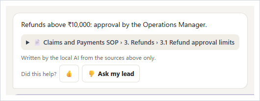

*Refund threshold answered with the approver and the source.*


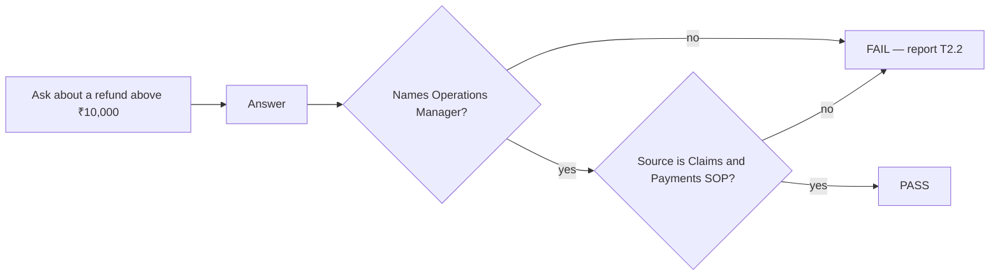

**Do**

1. As `m01`, ask: `Who approves a refund above ₹10,000?`

**Expect**

- The answer names the **Operations Manager** (and any second approver the SOP
  names).
- The source is **Claims and Payments SOP**, with a section about refunds.
- The rupee amount is not changed or rounded.

**Catch:** the approver is wrong, the amount is dropped, or the source is a
different document.

---

### T2.3 — Out-of-scope questions are refused and handed to the lead

`m01` + `lead` · Problem 1 · Guardrail + workflow

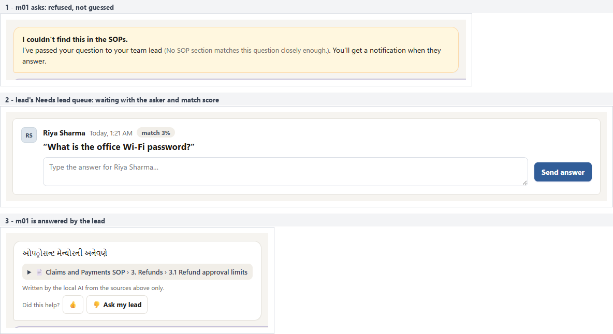

*Refusal, the lead's Needs lead queue, and the lead's answer back to the member.*


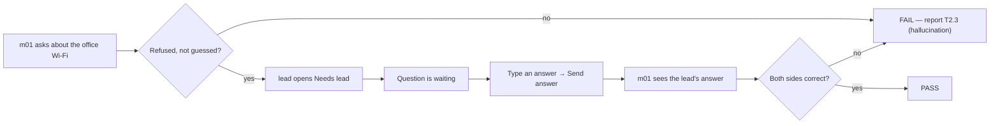

**Do**

1. As `m01`, ask: `What is the office Wi-Fi password?`
2. As `lead`, open **Needs lead** (the **Waiting** tab).
3. Find the question, type a short answer, press **Send answer**.
4. Back as `m01`, reopen **Ask the SOPs** and read the thread.

**Expect**

- The assistant says it could not find the answer in the SOPs and that the question
  was passed to the team lead. It does **not** invent a password.
- The question appears in Needs lead with the asker, time and match score.
- After the lead answers, `m01` sees “Answer from your team lead: …” and the
  question is no longer in the Waiting tab.

**Catch:** a fabricated answer, the question missing from Needs lead, or the
member never sees the reply.

---

### T2.4 — The hallucination guard holds for an invented code

`m01` · Problem 1 · Guardrail


*An invented error code is refused, not guessed.*


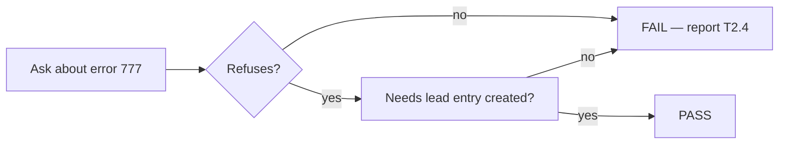

**Do**

1. As `m01`, ask: `What do I do when error 777 appears?`
2. Check **Needs lead** as `lead`.

**Expect**

- Refusal, with the reason that no SOP section matches closely enough.
- No invented steps, no invented escalation path.
- A new entry in **Needs lead**.

**Catch:** the assistant “helpfully” invents a procedure for 777.

---

### T2.5 — A newly uploaded SOP is indexed and used

`lead` · Problem 1 · Upload + retrieval

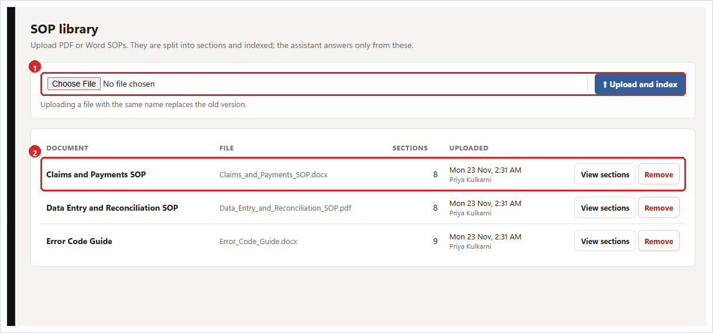

*SOP library upload; the new document is indexed with its section count.*


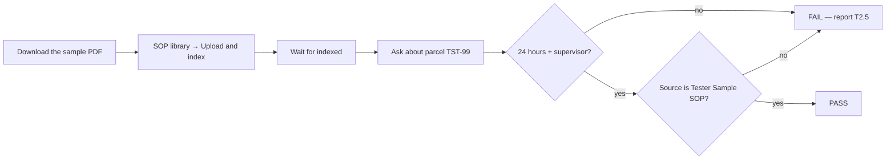

**Do**

1. Download `BASE_URL/static/samples/Tester_Sample_SOP.pdf`.
2. As `lead`, open **SOP library**.
3. Choose the file → **Upload and index**. Wait for the success message and the
   section count.
4. Open **Ask the SOPs** and ask:
   `What should I do when a parcel is marked TST-99?`

**Expect**

- The library lists **Tester Sample SOP** and its sections.
- The answer says to **hold it for 24 hours** and **inform the shift supervisor**
  before releasing it (and not to open it).
- The source is **Tester Sample SOP**, and the quoted excerpt contains TST-99.

**Catch:** the upload fails, the document is not searchable, or the answer comes
from a different SOP.

**Clean-up (optional):** delete the sample SOP from the library if the next tester
should start clean.

---

### T2.6 — Hindi and Gujarati questions still find the English SOP

`m01` · Problem 1 · Language

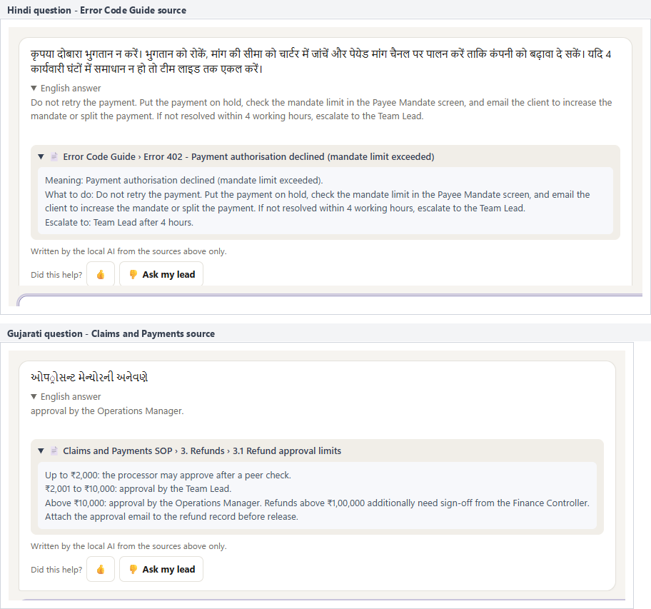

*Hindi and Gujarati questions, both answered from the English SOP with sources.*


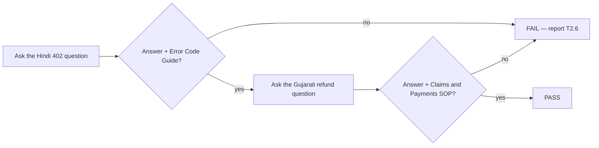

**Do**

1. As `m01`, ask: `त्रुटि 402 आने पर मुझे क्या करना चाहिए?`
2. Then ask: `₹10,000 થી વધુ રિફંડ કોણ મંજૂર કરે છે?`

**Expect**

- Both get an answer, not a “no match”.
- Hindi answer mentions 402 and cites **Error Code Guide**.
- Gujarati answer names the approver (Operations Manager) and cites **Claims and
  Payments SOP**.
- If the answer is in Hindi/Gujarati, an **English answer** disclosure is shown.

**Catch:** the question is refused, or the source is unrelated.

---

## Section 3 — Secure HR vault (Problem 2)

**What this proves:** files are encrypted before they hit disk, only the right
roles can see them, scans are searchable, and every action is recorded.

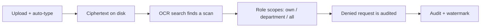

### T3.1 — Upload a document, detect its type, correct it

`hr1` · Problem 2 · Functional

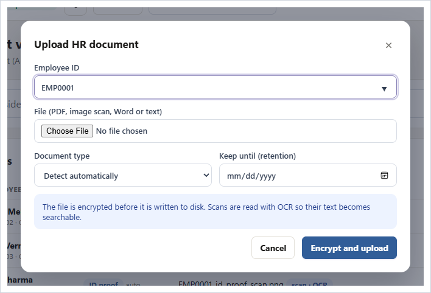

*Upload HR document with employee, file, auto-detect type and retention.*


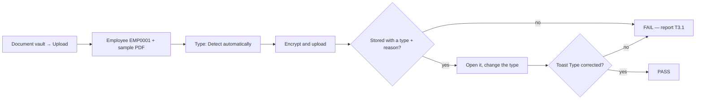

**Do**

1. Sign in as `hr1` → **Document vault** → **Upload document**.
2. Employee ID: `EMP0001` (pick Riya Sharma from the list).
3. File: the sample PDF from T2.5, or any small PDF/image/DOCX.
4. Document type: **Detect automatically**. Keep until: any future date.
5. Press **Encrypt and upload**, then open the new document.
6. Change **Type** to another value and watch for the toast.

**Expect**

- The upload succeeds and shows the detected type and the reason (rule or user).
- The document appears in the list with employee, type, file name, upload time and
  retention.
- Changing the type shows **“Type corrected”**, and reopening shows the new type.

**Catch:** the upload fails, the type is blank, or the correction does not stick.

---

### T3.2 — The file on disk is ciphertext

`admin` · Problem 2 · Encryption

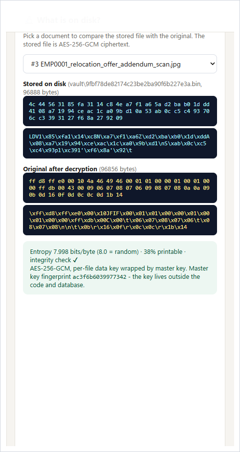

*Stored bytes start LDV1 and are unreadable; entropy 7.998 and integrity check pass.*


```mermaid
flowchart LR
  A["Sign in as admin"] --> B["Audit log"]
  B --> C["What is on disk? → choose a document"]
  C --> D{"Stored bytes start LDV1 and are unreadable?"}
  D -->|no| X["FAIL — report T3.2"]
  D -->|yes| E{"Entropy near 8.0 and integrity check passes?"}
  E -->|yes| P[PASS]
  E -->|no| X
```

**Do**

1. Sign in as `admin` → **Audit log**.
2. In **What is on disk?**, choose any document (for example #3).
3. Compare the **Stored on disk** hex with the **Original after decryption** hex.

**Expect**

- The stored head starts with `LDV1` and looks random; the original head is readable
  text (for example `%PDF`).
- Entropy is near **8.0 bits/byte**, printable ratio is low.
- **Integrity check** passes, and the master key fingerprint is shown.
- The key is not in the database or the code (the fingerprint is the only hint).

**Catch:** the stored bytes look like the original, entropy is low, or integrity
fails.

---

### T3.3 — A phrase inside a scan is found and highlighted

`hr1` · Problem 2 · OCR + search

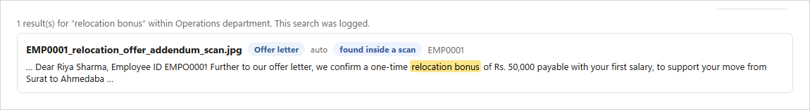

*Search for 'relocation bonus' finds the scan with a highlighted snippet.*

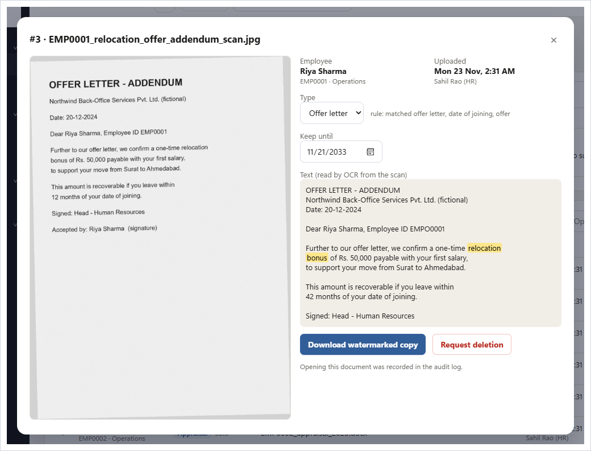

*The opened scan shows the OCR text panel with the match highlighted.*


```mermaid
flowchart LR
  A["Document vault search"] --> B["relocation bonus"]
  B --> C{"Result includes the scan?"}
  C -->|no| X["FAIL — report T3.3"]
  C -->|yes| D["Open it"]
  D --> E{"OCR text panel + highlighted match?"}
  E -->|yes| P[PASS]
  E -->|no| X
```

**Do**

1. As `hr1`, open **Document vault**.
2. Search: `relocation bonus`.
3. Find the result for `EMP0001_relocation_offer_addendum_scan.jpg` and open it.

**Expect**

- The result has a **“found inside a scan”** pill and a snippet with the match
  highlighted.
- The result count and scope label say **Operations department**.
- The opened document shows the text panel labelled **“read by OCR from the scan”**,
  with “relocation bonus” highlighted.
- Searching leaves an entry in the audit log (admin can confirm).

**Catch:** the scan is missing from results, or the match is not highlighted.

---

### T3.4 — Each role sees only its scope

`m01` + `hr1` + `admin` · Problem 2 · Permissions

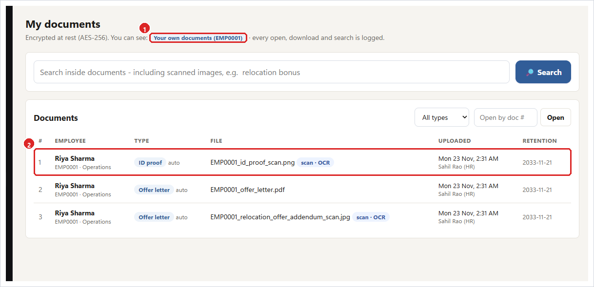

*m01's vault scope: own documents only (EMP0001).*


```mermaid
flowchart LR
  A["m01 → My documents"] --> B{"Only EMP0001?"}
  B -->|no| X["FAIL — report T3.4 (scope leak)"]
  B -->|yes| C["hr1 → Document vault"]
  C --> D{"Only Operations?"}
  D -->|no| X
  D -->|yes| E["admin → Document vault"]
  E --> F{"All departments?"}
  F -->|yes| G["Search as m01, then hr1"]
  G --> H{"Results respect the same scope?"}
  H -->|yes| P[PASS]
  H -->|no| X
```

**Do**

1. As `m01`, open **My documents**. Check the scope pill and every employee ID.
2. As `hr1`, open **Document vault**. Check the scope pill and departments.
3. As `admin`, open **Document vault**. Check the scope pill and count.
4. Search `relocation` as `m01`, then as `hr1`, then as `admin`.

**Expect**

- `m01`: scope **Your own documents (EMP0001)**; only Riya's documents.
- `hr1`: scope **Operations department**; only Operations employees.
- `admin`: scope **All departments**; all ten seeded documents plus any uploads.
- Search result counts follow the same scope, and a result from another department
  never appears.

**Catch:** any document from outside the scope is visible or searchable. This is an
**S1** finding.

---

### T3.5 — A denied request is denied clearly and recorded

`m01` + `admin` · Problem 2 · Access control + audit

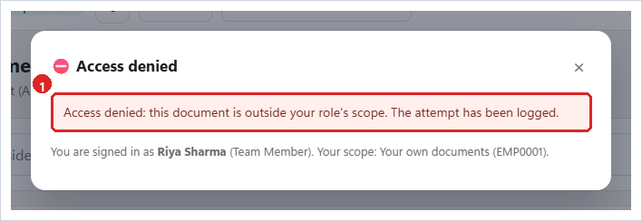

*Doc #7 (Finance) denied to m01, with role and scope shown.*


```mermaid
flowchart LR
  A["m01 opens Open by doc #"] --> B["Enter 7 (Finance)"]
  B --> C{"Access denied?"}
  C -->|no| X["FAIL — report T3.5 (S1)"]
  C -->|yes| D["admin → Audit log → Denied"]
  D --> E{"DENIED row for m01 / doc 7?"}
  E -->|yes| P[PASS]
  E -->|no| X
```

**Do**

1. As `m01`, open **My documents**.
2. In **Open by doc #**, enter `7` and press **Open**. (Doc 7 belongs to Finance.)
3. As `admin`, open **Audit log** → filter **Denied**.

**Expect**

- `m01` sees **Access denied**, with their name, role and scope.
- The document does not open and no text is leaked.
- The audit log has a **DENIED** row for `m01`, doc #7, with a timestamp.
- The hash chain badge stays **Chain intact**.

**Catch:** the document opens, or the denial is not logged.

---

### T3.6 — Audit trail and watermarked download

`hr1` + `admin` · Problem 2 · Audit + download

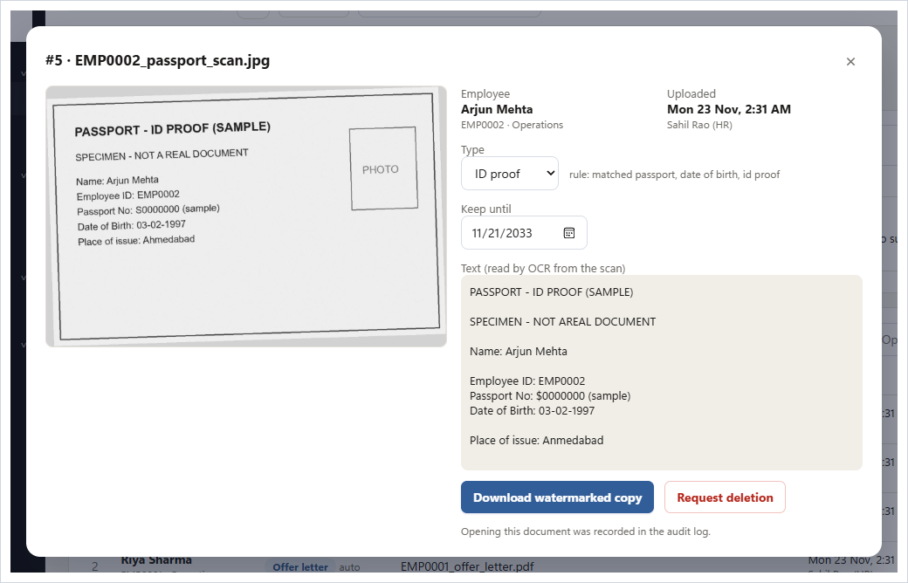

*Document view with Download watermarked copy (password re-check).*

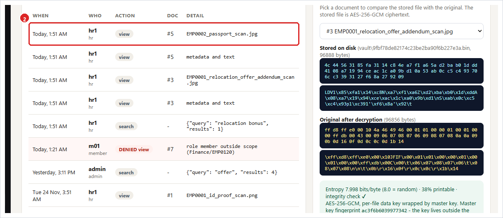

*Audit log with the chain-intact badge and the latest rows.*


```mermaid
flowchart LR
  A["hr1 opens a document"] --> B["Download watermarked copy"]
  B --> C["Re-enter password"]
  C --> D{"File downloads with CONFIDENTIAL stamp?"}
  D -->|no| X["FAIL — report T3.6"]
  D -->|yes| E["admin → Audit log"]
  E --> F{"Upload, view, download, search rows?"}
  F -->|yes| G{"No edit or delete control?"}
  G -->|yes| H{"Chain intact?"}
  H -->|yes| P[PASS]
  H -->|no| X
```

**Do**

1. As `hr1`, open a document you can see.
2. Press **Download watermarked copy** and re-enter the password (`demo1234`).
3. Open the downloaded file.
4. As `admin`, open **Audit log** and review the actions.

**Expect**

- The download happens only after the password re-check.
- The file is stamped **CONFIDENTIAL — hr1 — <time> IST — doc #N** (visible on the
  image/PDF).
- The audit log has rows for **upload**, **view**, **download** and **search**, each
  with user, time, action, document and detail.
- There is no edit or delete control anywhere in the audit UI.
- The chain badge says **Chain intact**.

**Catch:** a download without re-auth, no watermark, missing audit rows, or any
edit/delete affordance.

---

## Section 4 — Interview scheduler (Problem 3)

**What this proves:** a candidate can book without an account, two people cannot
take the same slot, invites and reminders arrive, and feedback stays independent.

```mermaid
flowchart LR
  A["Interviewer adds slots"] --> B["Recruiter invites candidate"]
  B --> C["Candidate books from a private window"]
  C --> D["ICS invite lands"]
  D --> E["Race: only one booking wins"]
  E --> F["Reschedule sends a new ICS"]
  F --> G["Feedback is hidden until yours is in"]
  G --> H["Reminder + cancellation"]
```

### T4.1 — One-off and recurring availability

`int1` · Problem 3 · Functional

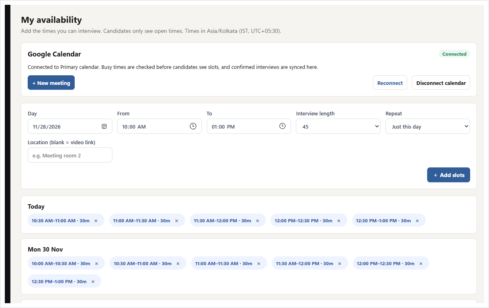

*Availability: one-off and recurring slot rules, with the calendar.*


```mermaid
flowchart LR
  A["Sign in as int1"] --> B["Availability"]
  B --> C["Day tomorrow, 10:00–13:00, 45 min, Just this day"]
  C --> D["Add slots"]
  D --> E{"Slots appear?"}
  E -->|no| X["FAIL — report T4.1"]
  E -->|yes| F["Repeat: same day for 2 more weeks"]
  F --> G{"3 weekly sets added?"}
  G -->|yes| P[PASS]
  G -->|no| X
```

**Do**

1. Sign in as `int1` → **Availability**.
2. Add: day **tomorrow**, from **10:00** to **13:00**, length **45**, repeat
   **Just this day**, location blank.
3. Press **Add slots**.
4. Add the same times again with repeat **Same day for 2 more weeks**.

**Expect**

- The first add creates four 45-minute slots (10:00, 10:45, 11:30, 12:15) and they
  appear as pills under tomorrow.
- The recurring add creates the same pattern on the next two matching days (three
  weeks in total), and the toast says how many were added or skipped.
- Overlapping times are skipped with a message, not duplicated.
- The candidate-facing length choices are 30/45/60.

**Catch:** wrong slot boundaries, duplicates, or a repeat that only creates one day.

---

### T4.2 — Invite, book from a private window, receive the `.ics`

`hr1` + candidate · Problem 3 · End-to-end

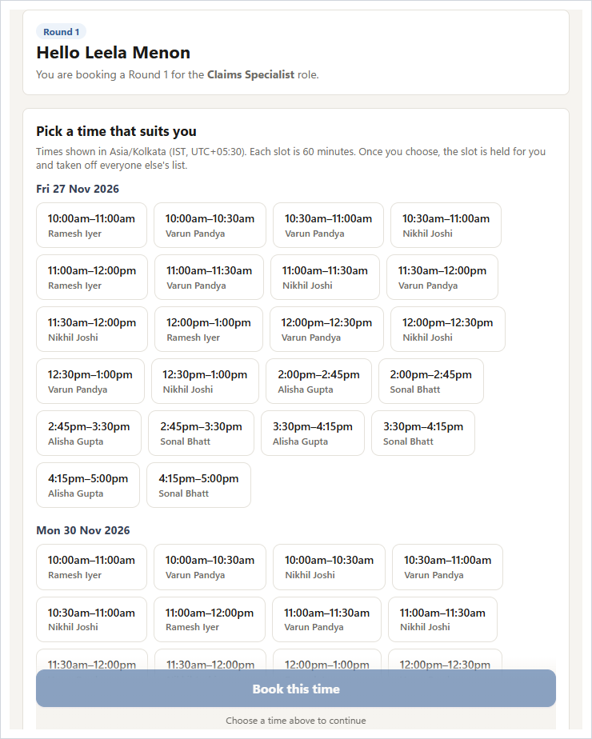

*Candidate booking page: open slots and Book this time.*


```mermaid
flowchart LR
  A["hr1 → Invite candidate"] --> B["Create booking link"]
  B --> C["Copy link"]
  C --> D["Open in private window"]
  D --> E["Pick a slot → Book this time → Confirm booking"]
  E --> F{"Confirmation with time + interviewer?"}
  F -->|no| X["FAIL — report T4.2"]
  F -->|yes| G["Open Mailpit / Sent emails"]
  G --> H{"Confirmation + .ics to candidate and interviewer?"}
  H -->|yes| I["Open the .ics"]
  I --> J{"Calendar shows date, time, join link?"}
  J -->|yes| P[PASS]
  J -->|no| X
```

**Do**

1. As `hr1`, open **Interviews** → **Invite candidate**.
2. Enter: name `Test Candidate A`, email `candidate.a@example.com`, role
   `Process Associate`, round `Round 1`, length `45`. Press **Create booking link**.
3. Press **Link** on the row (it copies and opens the link). Copy the URL.
4. Open the URL in a **private window**.
5. Pick an open slot → **Book this time** → **Confirm booking**.
6. Open Mailpit (or **Sent emails**) and find the confirmation.
7. Download and open the `.ics`.

**Expect**

- The booking page greets the candidate by name and shows only **open** times for
  the right interviewer/length.
- The booking needs two presses: **Book this time**, then **Confirm booking**.
- The confirmation shows the date/time in IST and the interviewer.
- The candidate and the interviewer each get an email with an `.ics` attachment.
- The `.ics` opens in a calendar app with the date, time, location/join link and a
  recognizable organizer.
- The board row moves to **Scheduled**; the slot no longer appears as open.

**Catch:** the link shows booked/blocked slots, the booking confirms but no invite
arrives, or the `.ics` is empty/corrupt.

---

### T4.3 — Two candidates, one slot: exactly one wins

`admin` (simulator) and two private windows · Problem 3 · Concurrency

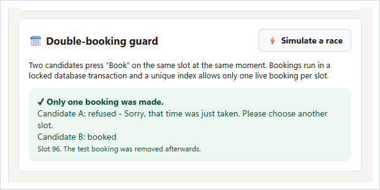

*Race simulator: exactly one booking, the other refused.*


```mermaid
flowchart LR
  A["Open the same booking link in two private windows"] --> B["Both choose the same slot"]
  B --> C["Press Book + Confirm in both, as close as possible"]
  C --> D{"Exactly one confirmation?"}
  D -->|no| X["FAIL — report T4.3 (S1)"]
  D -->|yes| E["Loser sees a clear taken message"]
  E --> F{"Board shows one booking?"}
  F -->|yes| G["admin → System proof → Simulate a race"]
  G --> H{"Simulator: Only one booking was made"}
  H -->|yes| P[PASS]
  H -->|no| X
```

**Do**

1. Create a second candidate (`Test Candidate B`) and copy both booking links.
2. Open link A in private window 1 and link B in private window 2.
3. Choose the **same** open slot in both.
4. Press **Book this time** → **Confirm booking** in both as close together as you
   can.
5. As `admin`, open **System proof** → **Double-booking guard** → **Simulate a
   race**.

**Expect**

- Exactly one candidate gets a confirmed booking.
- The other sees a clear message that the slot was taken and is offered other times
  (or a refresh).
- The board has one booking for that slot; the slot is booked once.
- The simulator reports **“Only one booking was made.”** and cleans up its test
  booking.

**Catch:** both confirmations succeed, or the loser gets a server error instead of a
clear message. This is an **S1** finding.

---

### T4.4 — Reschedule moves the booking and sends a new invite

Candidate + `hr1` · Problem 3 · Change flow

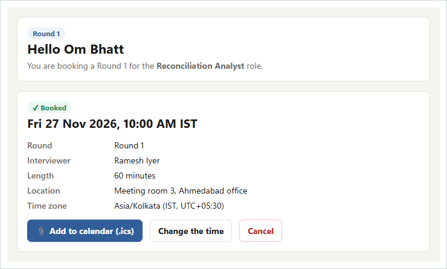

*Booked confirmation with Change the time and Cancel.*

```mermaid
flowchart LR
  A["Candidate opens the same link"] --> B["Change the time"]
  B --> C["Pick another open slot → Confirm"]
  C --> D{"Confirmation shows the new time?"}
  D -->|no| X["FAIL — report T4.4"]
  D -->|yes| E["Board status = Rescheduled"]
  E --> F{"New .ics with a higher sequence?"}
  F -->|yes| G{"Old slot is free again?"}
  G -->|yes| P[PASS]
  G -->|no| X
```

**Do**

1. Reopen the candidate's booking link (from T4.2).
2. Press **Change the time**.
3. Pick a different open slot and confirm.
4. As `hr1`, check the board row and the emails.
5. Check that the old slot is open again on the booking page.

**Expect**

- The page shows the new time and “Moved 1 time”.
- The board row shows **Rescheduled** and the new time, with a reschedule count.
- Candidate and interviewer get a new `.ics`; in a calendar app it updates the same
  event (sequence increases), rather than creating a duplicate.
- The old slot is offered again; the new slot is no longer open.

**Catch:** the old booking survives, the calendar creates a duplicate, or no new
invite is sent.

---

### T4.5 — Feedback is independent and hidden until you submit

`int1` + `int2` + `hr1` · Problem 3 · Privacy + structure

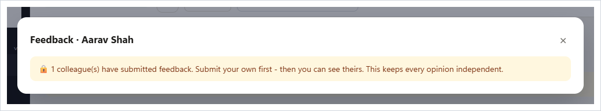

*Feedback lock: a colleague has submitted; yours must come first.*


```mermaid
flowchart LR
  A["int1 opens a candidate with two rounds"] --> B["Feedback before submitting"]
  B --> C{"Colleague feedback hidden?"}
  C -->|no| X["FAIL — report T4.5 (S1)"]
  C -->|yes| D["Rate 4 criteria + recommendation + comment"]
  D --> E["Submit"]
  E --> F{"Now sees both feedbacks?"}
  F -->|yes| G["hr1 board shows Feedback pending / Completed"]
  G --> H{"Filters by recruiter + role work?"}
  H -->|yes| P[PASS]
  H -->|no| X
```

**Do**

1. As `int1`, open **My interviews** and find a candidate with feedback pending
   (the seed gives one candidate two rounds with different interviewers).
2. Press **Give feedback** (or **Feedback**).
3. Press **See colleagues' feedback** before submitting.
4. Rate all four criteria (1–5), choose **Advance/Hold/Reject**, add a comment,
   press **Submit feedback**.
5. As `int2`, open the same candidate and submit feedback.
6. As `hr1`, open **Interviews** and use the recruiter and role filters.

**Expect**

- Before submitting, `int1` sees a lock message: N colleagues have submitted, submit
  yours first.
- The form requires all four ratings and a recommendation; it refuses an incomplete
  submit.
- After submitting, `int1` sees both feedbacks side by side.
- The board shows **Feedback pending** until feedback exists, then **Completed**.
- The recruiter and role dropdowns filter the rows; the KPI tiles filter by status.

**Catch:** a colleague's feedback is visible before submitting, or an incomplete
form saves.

---

### T4.6 — Reminder at 24 hours and cancellation

`int1` + `hr1` + candidate · Problem 3 · Scheduled jobs + mail

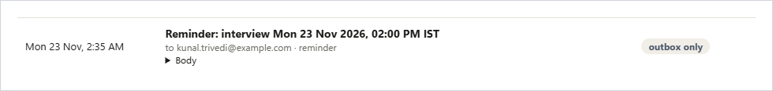

*Reminder email in Sent emails, addressed to the interviewer.*


```mermaid
flowchart LR
  A["int1 adds a slot about 23 h from now"] --> B["hr1 invites + candidate books"]
  B --> C["Wait up to 2 minutes"]
  C --> D{"Reminder in Mailpit?"}
  D -->|no| X["FAIL/BLOCKED — report T4.6"]
  D -->|yes| E["hr1 cancels from the board"]
  E --> F{"Cancellation mail + board Cancelled?"}
  F -->|yes| G{"Slot freed?"}
  G -->|yes| P[PASS]
  G -->|no| X
```

**Do**

1. As `int1`, add a slot for **tomorrow, one hour earlier than the current time**
   (about 23 hours away), length 30.
2. As `hr1`, invite a candidate, copy the link, and book that slot in a private
   window.
3. Wait up to **2 minutes** for the scheduler tick.
4. Open Mailpit (or **Sent emails**) and find the **Reminder: interview …** message
   to the candidate and the interviewer.
5. As `hr1`, press **Cancel** on the board row and confirm.
6. Check the mail and the board.

**Expect**

- A reminder email arrives within about 2 minutes, addressed to both sides, with the
  time and the join link.
- Cancelling asks for confirmation, sends a **cancellation** to both sides, and the
  board row becomes **Cancelled**.
- The slot is free again on the booking page (the candidate sees no active booking).

**Catch:** no reminder after 3 minutes (mark **BLOCKED** and note the time), no
cancellation mail, or the slot stays blocked.

---

## Section 5 — Cross-cutting access, security and UX

**What this proves:** the roles hold outside the happy path, sign-in resists
guessing, the app works on a phone, and testers can report problems.

```mermaid
flowchart LR
  A["Role boundaries"] --> B["Sign-in lockout"]
  B --> C["Logout + deep links"]
  C --> D["Mobile layout"]
  D --> E["Report a problem"]
  E --> F["Performance + console"]
```

### T5.1 — Role boundaries hold on direct URLs

`m01`, `hr1`, `tester` · Cross-cutting · Permissions

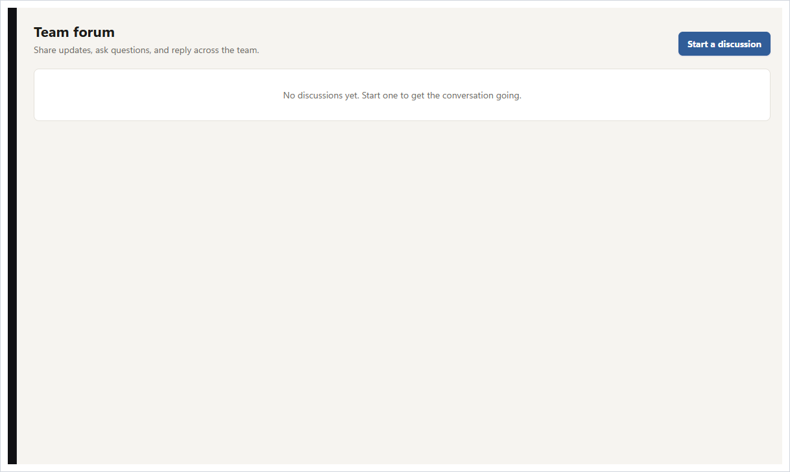

*tester opening #/vault lands on the forum - no vault data.*


```mermaid
flowchart LR
  A["m01 opens #/board"] --> B{"Redirected to My tasks?"}
  B -->|no| X["FAIL — report T5.1 (S1)"]
  B -->|yes| C["m01 opens #/audit"]
  C --> D{"Redirected, no audit data?"}
  D -->|yes| E["hr1 opens #/audit"]
  E --> F{"Redirected?"}
  F -->|yes| G["tester opens #/vault"]
  G --> H{"Forum only?"}
  H -->|yes| P[PASS]
  H -->|no| X
```

**Do**

1. As `m01`, put `#/board` in the URL.
2. As `m01`, put `#/audit` in the URL.
3. As `hr1`, put `#/audit` in the URL.
4. As `tester`, put `#/vault` in the URL.
5. As `tester`, try to open a vault document by number.

**Expect**

- Every attempt lands on that role's home page (or a clear denial), never on the
  lead/admin page.
- No audit entries, salaries or documents are rendered.
- The API, not just the menu, refuses the action.

**Catch:** a page renders data outside the role. **S1**.

---

### T5.2 — Five wrong passwords lock the account for 60 seconds

`tester` · Cross-cutting · Brute force

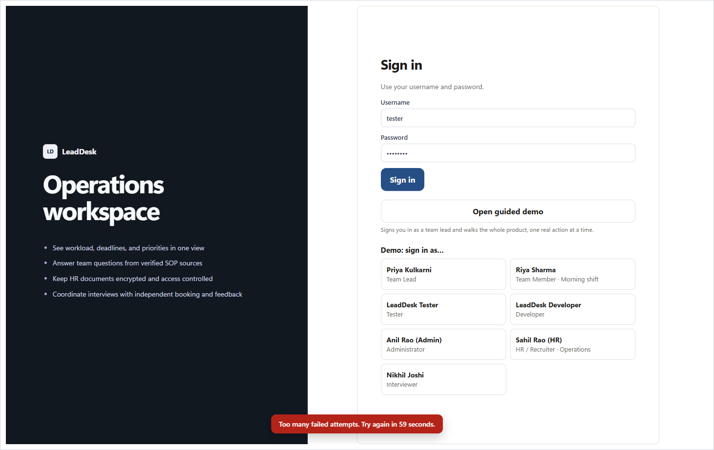

*Lockout after five failures: 'Too many failed attempts. Try again in 59 seconds.'*


```mermaid
flowchart LR
  A["Sign out"] --> B["Wrong password ×5 for tester"]
  B --> C{"Locked message?"}
  C -->|no| X["FAIL — report T5.2"]
  C -->|yes| D["Wait 60 s, sign in correctly"]
  D --> E{"Sign-in works again?"}
  E -->|yes| P[PASS]
  E -->|no| X
```

**Do**

1. Sign out.
2. Try `tester` with a wrong password five times.
3. Try the correct password once.
4. Wait 60 seconds and try the correct password again.

**Expect**

- After five failures, sign-in is refused with a lockout message for that account
  and this IP.
- The correct password is also refused while locked.
- After 60 seconds, the correct password works.

**Catch:** unlimited guesses, or the lockout never expires. Do **not** run this on
`lead` or `admin` if other testers are working.

---

### T5.3 — Sign-out and deep links do not restore a session

`lead` · Cross-cutting · Session


*After Sign out, Back and deep links return to the login page.*


```mermaid
flowchart LR
  A["Sign in as lead"] --> B["Sign out"]
  B --> C{"Login page?"}
  C -->|no| X["FAIL — report T5.3"]
  C -->|yes| D["Press Back"]
  D --> E{"No data, still signed out?"}
  E -->|yes| F["Open #/audit directly"]
  F --> G{"Redirected to login?"}
  G -->|yes| P[PASS]
  G -->|no| X
```

**Do**

1. Sign in as `lead`, then sign out.
2. Press the browser Back button.
3. Open `BASE_URL/#/audit` directly.

**Expect**

- Sign-out returns to the login page.
- Back does not restore the workspace or cached personal data.
- The deep link redirects to the login page (or denies), not to an audit view.

**Catch:** the workspace is still visible after sign-out.

---

### T5.4 — The app is usable at phone width

`m01` · Cross-cutting · Responsive

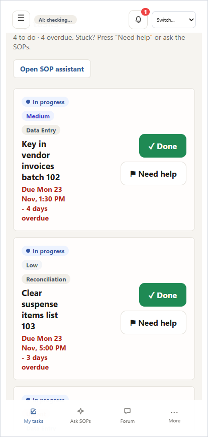

*390 px phone layout: no horizontal scroll, bottom navigation.*


```mermaid
flowchart LR
  A["Open DevTools device mode at 390 px"] --> B["My tasks"]
  B --> C{"No horizontal scrolling?"}
  C -->|no| X["FAIL — report T5.4"]
  C -->|yes| D["Open the menu"]
  D --> E{"Drawer navigates?"}
  E -->|yes| F["Open the assistant + a task"]
  F --> G{"Readable and tappable?"}
  G -->|yes| P[PASS]
  G -->|no| X
```

**Do**

1. In Chrome, open DevTools → device toolbar → **iPhone 14 / 390 px**.
2. Sign in as `m01`.
3. Navigate: **My tasks**, open a task, **Ask the SOPs**, send a question, open the
   menu and go to another page.
4. Repeat on the public booking page (private window).

**Expect**

- No horizontal scrollbar on any page.
- The bottom tabs and the hamburger menu work; the drawer closes after navigation.
- Buttons are large enough to tap; text does not overlap.
- The assistant input stays visible above the keyboard area.

**Catch:** content cut off, a table that cannot be scrolled, or a menu that traps
you.

---

### T5.5 — The in-app report reaches the team

`m01` · Cross-cutting · Reporting


*Filled Report a problem dialog with area, severity, summary and steps.*


```mermaid
flowchart LR
  A["Account menu → Report a problem"] --> B["Fill area, severity, summary, steps"]
  B --> C["Send report"]
  C --> D{"Toast: Report sent?"}
  D -->|no| X["FAIL — report T5.5"]
  D -->|yes| E["Check Mailpit or Sent emails"]
  E --> F{"Subject starts [LeadDesk][severity][area]?"}
  F -->|yes| G{"Body has account, page, steps?"}
  G -->|yes| P[PASS]
  G -->|no| X
```

**Do**

1. As `m01`, open the account menu → **Report a problem**.
2. Area: **Interviews**; Severity: **Major**; Summary:
   `T5.5 test report — please ignore`; Steps: `1. Open the form 2. Press Send`.
3. Press **Send report**.
4. Check Mailpit / **Sent emails**.

**Expect**

- A success toast appears and the modal closes.
- The email subject is
  `[LeadDesk][major][Interviews] T5.5 test report — please ignore`.
- The body includes the sender's name, username and role, the page URL, the steps,
  expected and actual.
- The message is listed even if SMTP is down (outbox only).

**Catch:** the form errors, nothing is stored, or the body is missing fields.

**This report is a test — tell the organiser it was a drill.**

---

### T5.6 — Pages load cleanly and the AI answers in time

`lead` · Cross-cutting · Performance

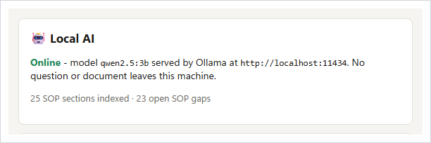

*Local AI online (qwen2.5:3b) and 25 SOP sections indexed.*


```mermaid
flowchart LR
  A["Open DevTools Console"] --> B["Visit Overview, Board, Assistant, Vault, Interviews"]
  B --> C{"Any red errors on load?"}
  C -->|no| D["Ask one SOP question"]
  C -->|yes| X["FAIL — screenshot console + report T5.6"]
  D --> E{"Answer under 60 s?"}
  E -->|yes| F{"Pages feel responsive (< 2 s on LAN)?"}
  F -->|yes| P[PASS]
  F -->|no| X
  E -->|no| X
```

**Do**

1. Open DevTools → Console. Keep it open.
2. Visit Overview, Task board, Ask the SOPs, Documents, and Interviews.
3. Ask the 402 question once.

**Expect**

- No red console errors on load (a single 401 from `/api/auth/me` before signing in
  is expected; ignore it).
- Pages render in under ~2 seconds on the local network; no infinite spinners.
- The AI answer arrives in under 60 seconds; the typing indicator is visible while
  waiting.
- No layout jump that moves the input out from under the cursor.

**Catch:** a 500, a red stack trace, a page stuck on “Loading…”, or the assistant
never returns.

---

## 6. Results sheet

Copy this into a spreadsheet, or use `docs/tester-results.csv`.

| Test | Result | Severity | Notes | Report sent |
|---|---|---|---|---|
| T0.1 |  |  |  |  |
| T0.2 |  |  |  |  |
| T0.3 |  |  |  |  |
| T1.1 |  |  |  |  |
| T1.2 |  |  |  |  |
| T1.3 |  |  |  |  |
| T1.4 |  |  |  |  |
| T1.5 |  |  |  |  |
| T1.6 |  |  |  |  |
| T2.1 |  |  |  |  |
| T2.2 |  |  |  |  |
| T2.3 |  |  |  |  |
| T2.4 |  |  |  |  |
| T2.5 |  |  |  |  |
| T2.6 |  |  |  |  |
| T3.1 |  |  |  |  |
| T3.2 |  |  |  |  |
| T3.3 |  |  |  |  |
| T3.4 |  |  |  |  |
| T3.5 |  |  |  |  |
| T3.6 |  |  |  |  |
| T4.1 |  |  |  |  |
| T4.2 |  |  |  |  |
| T4.3 |  |  |  |  |
| T4.4 |  |  |  |  |
| T4.5 |  |  |  |  |
| T4.6 |  |  |  |  |
| T5.1 |  |  |  |  |
| T5.2 |  |  |  |  |
| T5.3 |  |  |  |  |
| T5.4 |  |  |  |  |
| T5.5 |  |  |  |  |
| T5.6 |  |  |  |  |

---

## 7. Sign-off

The build is ready to show when:

- [ ] All **T0** tests pass, including **AI online**.
- [ ] Every **P1** test (T1.x, T2.x) passes, or the failure is S3/S4 and accepted.
- [ ] Every **P2** test (T3.x) passes, with **no S1 scope leak**.
- [ ] Every **P3** test (T4.x) passes, including **exactly one booking** in T4.3.
- [ ] No open **S1** or **S2** report.
- [ ] Every failure has a report with a screenshot.

---

## 8. Known limits — do not report these as bugs

| Behaviour | Why it is expected |
|---|---|
| AI badge says offline, answers still arrive | The assistant falls back to quoting the best SOP section. Report it under **T0.2** if the deployment promised an online model, but the answer itself is not wrong. |
| The first AI answer is slow | The model loads on first use; later answers are faster. |
| Shared Google calendars do not block slots | Busy checks use the **primary** calendar only; a documented limitation. |
| Panel interviews are multiple rounds | Each round has its own interviewer and independent feedback. |
| `tester` and `dev` see only the forum | Those roles are intentionally restricted. |
| Mailpit receives everything in the demo | It is a test inbox, not a real mail service. |
| Google Calendar controls are missing | OAuth is optional and not configured on every instance. |
| Sample data is synthetic | Names, salaries and documents are fabricated for the demo. |
| ClamAV/audit shipping are silent | They are optional controls; the app works without them. |

---

## Appendix A — Copy-paste test data

### Questions

| Purpose | Exact text | Expected |
|---|---|---|
| T2.1 | `What do I do when error 402 appears?` | 402, hold, Error Code Guide |
| T2.2 | `Who approves a refund above ₹10,000?` | Operations Manager, Claims and Payments SOP |
| T2.3 | `What is the office Wi-Fi password?` | Refused + Needs lead |
| T2.4 | `What do I do when error 777 appears?` | Refused + Needs lead |
| T2.5 | `What should I do when a parcel is marked TST-99?` | 24 hours, shift supervisor, Tester Sample SOP |
| T2.6 | `त्रुटि 402 आने पर मुझे क्या करना चाहिए?` | 402, Error Code Guide |
| T2.6 | `₹10,000 થી વધુ રિફંડ કોણ મંજૂર કરે છે?` | Operations Manager, Claims and Payments SOP |

### Vault scan phrase

Search: `relocation bonus` → `EMP0001_relocation_offer_addendum_scan.jpg`
(Operations, EMP0001). The OCR text also says “42 months”.

### Document IDs used in the guide

| ID | Employee | Department | File |
|---|---|---|---|
| 7 | EMP0120 | Finance | `EMP0120_appraisal_scan.pdf` |
| 3 | EMP0001 | Operations | `EMP0001_relocation_offer_addendum_scan.jpg` |

### Candidate emails

Use `candidate.a@example.com` and `candidate.b@example.com`. In the Docker demo,
Mailpit catches them; they do not need to be real.

### Sample SOP for upload

`BASE_URL/static/samples/Tester_Sample_SOP.pdf` — a one-page fictional procedure
with the code **TST-99**.

---

## Appendix B — What a good failure report contains

```mermaid
flowchart LR
  A["Test ID"] --> B["Account + instance"]
  B --> C["Time, browser, AI badge"]
  C --> D["Steps to reproduce"]
  D --> E["Expected vs actual"]
  E --> F["Screenshot + console"]
  F --> G["Severity"]
```

A report is actionable when the reader can repeat it without asking you a question.
“It didn't work” is not actionable; “T4.3: both private windows confirmed the same
09:45 slot; board shows two bookings” is.
